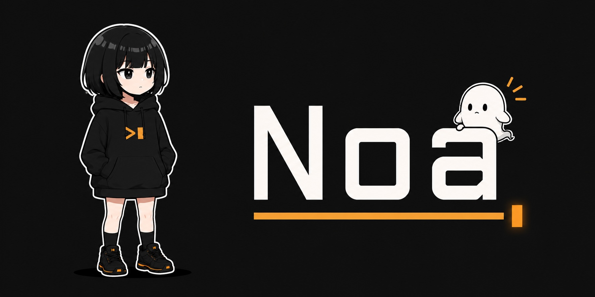

# Noa

Noa is a terminal emulator that reproduces the observable behavior of
[Ghostty](https://ghostty.org), written independently in Rust with `winit` and
`wgpu`. It is macOS-first (Apple Silicon, macOS 13 or later) and also runs on
Linux (X11 and Wayland).

It exists to keep Ghostty's behavior and configuration format while adding two
things: high sustained output throughput (`cat huge.log`, build logs, CI
streams), and worker panes that a coding agent (Claude Code, Codex, agy) in
another pane can spawn, prompt, and read through `Noa +ctl`.

```bash
# Apple Silicon Mac, from the Homebrew tap in this repository
brew tap simota/noa https://github.com/simota/Noa.git
brew install --cask simota/noa/noa

# Any supported platform, from source (Rust 1.92 or newer)
cargo run -p noa
```

Noa is under active development. Website: <https://simota.github.io/Noa/>

## Install

### macOS: Homebrew

The cask (`Casks/noa.rb`) requires an Apple Silicon Mac running macOS 13
(Ventura) or later. It downloads `Noa-<version>-macos-arm64.zip` from the
GitHub Release matching the cask version and installs `Noa.app`.

Release archives are Developer ID signed and notarized when the release
workflow has signing secrets; otherwise they are ad-hoc signed. The cask uses
`sha256 :no_check`; each release publishes the archive's SHA-256 checksum
alongside it.

### macOS: from source

Use Rust 1.92 or newer (edition 2024); CI builds with Rust 1.92.0.

```bash
cargo run -p noa                 # run the debug build
scripts/bundle-macos.sh          # build target/release/Noa.app
open target/release/Noa.app
```

The bundle script produces a locally ad-hoc-signed app, not a notarized
distribution.

### Linux

Build dependencies (Debian/Ubuntu package names):

```bash
sudo apt install build-essential pkg-config libfontconfig1-dev libfreetype-dev \
  libxkbcommon-dev libwayland-dev
```

At runtime Noa needs a Vulkan driver (Mesa or a vendor driver), with OpenGL ES
as a fallback, and loads X11/Wayland and `libxkbcommon` dynamically.

Tagged releases publish `Noa-<version>-linux-x86_64.tar.gz`;
`scripts/package-linux.sh` builds the same layout locally as
`target/release/Noa-<version>-linux-<arch>.tar.gz`. Each tarball unpacks to one
directory holding the binary, desktop entry, AppStream metadata, icons, and
`install.sh`, which installs into `~/.local` by default. Run this in the
directory that holds the tarball (`target/release/` for a local build):

```bash
version='<version>'                   # replace with the version in the file name
pkg="Noa-$version-linux-x86_64"       # a local build uses your arch (uname -m)
stage=$(mktemp -d)
tar -xzf "$pkg.tar.gz" -C "$stage"
"$stage/$pkg/install.sh"              # or: --prefix /usr/local (with sudo)
"$stage/$pkg/install.sh" --uninstall  # remove again (same --prefix, if any)
```

See [docs/LINUX.md](docs/LINUX.md#installing) for fonts, desktop integration,
and troubleshooting.

## Usage

### Command line

The executable is named `Noa`. From a checkout, pass arguments after `--`:

```bash
cargo run -p noa -- --cols 100 --rows 30 --font-size 15
cargo run -p noa -- -e htop          # run a command instead of the login shell
```

From a Homebrew install, the executable is
`/Applications/Noa.app/Contents/MacOS/Noa`.

| Flag | Effect |
|---|---|
| `--cols N`, `--rows N` | Initial grid size in cells |
| `--font-size PT` | Font size in points |
| `-e COMMAND...` | Run a command instead of the login shell; must be the last flag |
| `--config-default-files=false` | Ignore config files and use built-in defaults plus flags |
| `--import-ghostty-config` | Import a Ghostty configuration (see below) and exit |

One-shot actions run without opening a window: `+version`, `+list-themes`,
`+list-keybinds`, `+list-fonts`, `+show-config`, `+explain-config`,
`+list-actions`, `+help`, and `+ctl`.

### Keybindings

macOS uses ⌘-based shortcuts. On Linux the defaults are Ghostty's Linux (GTK)
bindings: `ctrl+shift+c` / `ctrl+shift+v` copy and paste, `ctrl+shift+t` opens
a tab, `ctrl+shift+p` opens the command palette. The macOS table and the
`keybind =` syntax are in [docs/KEYBINDINGS.md](docs/KEYBINDINGS.md); the Linux
table is in [docs/LINUX.md](docs/LINUX.md#default-keybindings).

### Features

Noa has tabs, splits, floating panes, session restore, a quick terminal, the
Kitty keyboard and graphics protocols, Sixel, shell integration for bash, zsh,
and fish, and 575 bundled themes (574 from Ghostty plus `Noa`).
[docs/FEATURES.md](docs/FEATURES.md) is the complete inventory.

### Start a project with Scaffold

Open **View → Scaffold** on macOS, or **Open Scaffold** from the command
palette, to inspect the project in the focused pane. The setup view finds
getting-started documents, working agreements, dependency definitions,
runtime settings, verification entry points, and CI configuration, including
projects that have no Noa asset registry yet.

Review the detected assets before adding them to the project's registry, or
preview a task for the missing preparation and continue in **View → Tasks**.
Scaffold reads project files without running their commands; a detected file
does not mean the environment is installed or verified. Search and the
**要対応** (Needs attention) filter help you choose the next step.

See [the Scaffold guide](docs/SCAFFOLD.md) for the workflow, keyboard controls,
and what each action writes. Scaffold is included in the macOS app; Linux
users can build it from source, but it is not in the Linux release package.

## Configuration

Noa reads `$XDG_CONFIG_HOME/noa/config`, or `~/.config/noa/config` when
`XDG_CONFIG_HOME` is unset. The format is Ghostty's `key = value`; CLI flags
override file values, and the file is reloaded while Noa runs.

```conf
window-width = 100
window-height = 30
font-size = 15.0
theme = "Catppuccin Mocha"
```

See [docs/CONFIGURATION.md](docs/CONFIGURATION.md) for every key, its accepted
values and default, and the defaults that deliberately differ from Ghostty.

### Importing a Ghostty configuration

```bash
cargo run -p noa -- --import-ghostty-config
/Applications/Noa.app/Contents/MacOS/Noa --import-ghostty-config   # Homebrew install
```

The import reads every existing Ghostty configuration in this order:

1. `$XDG_CONFIG_HOME/ghostty/config.ghostty`
2. `$XDG_CONFIG_HOME/ghostty/config`
3. `~/Library/Application Support/com.mitchellh.ghostty/config.ghostty`
4. `~/Library/Application Support/com.mitchellh.ghostty/config`

When `XDG_CONFIG_HOME` is unset or empty, the first two use `~/.config`. The
contents are appended in that order, so later scalar values win and `keybind`
lines keep their order. Supported scalar settings and `keybind` lines are
copied unchanged. Unsupported keys and unparsable lines are kept as comments;
existing comments and blank lines are preserved. `config-file` directives are
commented out and the files they name are not followed.

The import writes the Noa configuration path above and refuses to overwrite an
existing file; move it aside first if you want to replace it.

## Agent orchestration

An agent or script in one pane can drive worker panes with `Noa +ctl`: spawn
Claude Code, Codex, agy, or any command, send prompts, wait on each worker's
reported state, read its output, and close it. Every command prints one JSON
object per line. The first spawn opens `Noa +ctl board` beside the
orchestrator: workers that need a person are queued above the tree of work in
progress, with a preview of the selected worker's screen. Workers live in
floating panes stowed on the board.

`+ctl` needs the control server, which is off by default:

```conf
server-enable = true
server-scopes = read,control,input
```

See [docs/AGENT_WORKFLOW.md](docs/AGENT_WORKFLOW.md#orchestrating-worker-panes)
for the commands and a full round, and for attention tracking and pane-scoped
notifications.

## Performance

The two figures below come from different sources. Each row states only what
its source records, and both predate the current release:

| Measurement | Result | Source |
|---|---|---|
| Output throughput (plain / ANSI / CJK) | 220–233 MB/s; CJK fastest at 233 MB/s | [docs/positioning.md](docs/positioning.md), 2026-07-17, 5-run median |
| Input latency, DSR round-trip proxy | median 25 µs, p95 63 µs, p99 152 µs | `bench/run_all.sh --axes latency`, 2026-07-29, Noa 0.2.2 build, Apple M1 Pro, 10 launches × 1000 samples |

The latency axis times an `ESC[6n` cursor-position request and its reply
through the pty, VT parser, and responder, the same path a keystroke echo
takes. It does not include keyboard hardware or display refresh, so it is not
keyboard-to-glass latency.

The bundled harness, `bench/run_all.sh`, measures throughput, input latency,
scroll, warm startup, memory, CPU load, and an IO stress test, and can compare
Noa with other installed terminals. Its throughput axis uses an ASCII file and
a mixed-Unicode file and reports MiB/s, not the plain/ANSI/CJK split above.
Re-run it to measure the build you have. Results go to `bench/results/`,
which is not committed. [bench/METHODOLOGY.md](bench/METHODOLOGY.md) defines
each axis. [docs/positioning.md](docs/positioning.md) states the performance
claim and the guardrails applied to performance changes.

## Compatibility and limitations

Noa is an independent reimplementation: it contains and links no Ghostty
source code. Compatibility targets observable terminal behavior, not
source-level equivalence.

- Parity is protected by fixture-based regression tests
  ([tests/parity](tests/parity/README.md)). Automated differential comparison
  against a running Ghostty is not implemented yet, and some advanced terminal
  behavior may still differ.
- macOS is the primary platform.

On Linux, as listed in
[Differences from macOS](docs/LINUX.md#differences-from-macos):

- `quick-terminal-hotkey` is not registered system-wide (a
  `toggle_quick_terminal` keybinding works while a Noa window is focused), and
  on Wayland the quick terminal does not slide.
- The menu bar and Ember, AppleScript, Dock badges, background blur, and the
  native AppKit overlay cards are absent; the GPU renderer draws the command
  palette and dialogs instead.
- File previews open in your editor.
- Restored sessions come back without their scrollback, because encrypted
  scrollback persistence needs the macOS Keychain.

See the [parity roadmap](docs/roadmaps/ghostty-parity-roadmap.md) for planned
work.

## Development

```bash
scripts/verify.sh            # format, dependency-boundary checks, and tests the change reaches
scripts/verify.sh --full     # every check; what CI runs on macOS and Linux
cargo build --workspace
cargo test --workspace
cargo fmt --all
```

Noa is a Cargo workspace. `noa-vt` (parser) and `noa-grid` (terminal state)
have no windowing dependencies and are unit-testable without a window or GPU.
`noa-render` owns GPU rendering, `noa-app` owns the `winit` event loop and
platform integration, and `bin/noa` is a thin entry point. Only `noa-app` and
`noa-render` may use `wgpu`, and only `noa-app` may use `winit`;
`scripts/verify.sh` checks this.

[AGENTS.md](AGENTS.md) covers repository layout, verification, safety rules,
and commit conventions. [docs/feature-map.md](docs/feature-map.md) maps each
feature to its code and tests.

## Releasing

Maintainers only. `scripts/release.sh` publishes the version declared in
`Cargo.toml` and `Casks/noa.rb`:

```bash
scripts/release.sh --dry-run   # every preflight check, no tag
scripts/release.sh             # asks for confirmation, then pushes v<version>
```

It requires a clean `main` that matches `origin/main`, runs formatting and the
locked workspace build and tests, then creates and pushes the `v<version>`
tag. `--yes` skips the confirmation and is meant only for trusted automation.
The tag triggers the release workflow, which checks that the Cargo, cask, tag,
and app-bundle versions match before publishing the archives and checksums.
[docs/release-signing.md](docs/release-signing.md) covers the signing and
notarization secrets.

To withdraw an invalid release before users depend on it, delete the GitHub
Release first, then its remote and local tags:

```bash
version='<version>'                   # the release to withdraw, e.g. 0.9.12
gh release delete "v$version" --repo simota/Noa --yes
git push origin ":refs/tags/v$version"
git tag -d "v$version"
```

## License

MIT. See [LICENSE](LICENSE).
