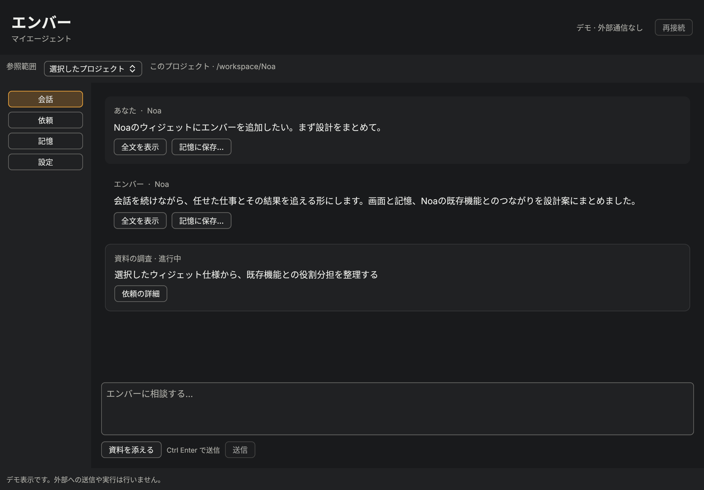
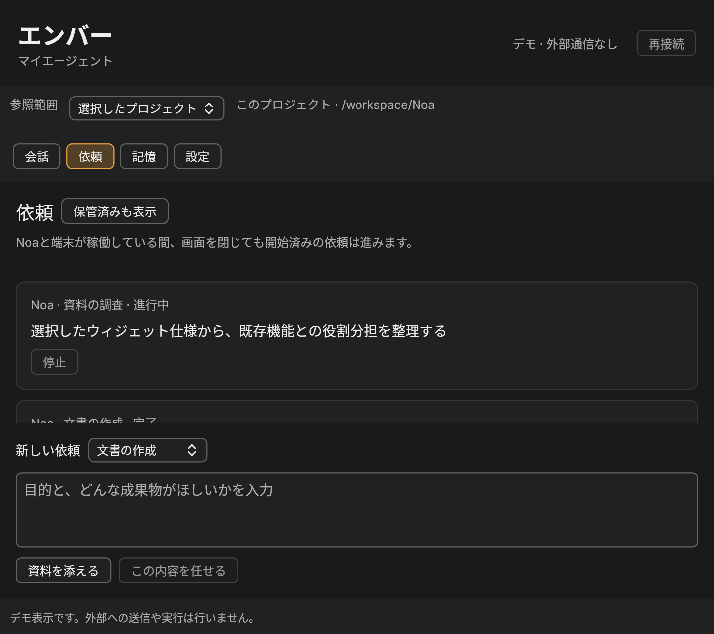

# Ember: a personal assistant widget

Ember adds a persistent assistant window to Noa. It can hold a conversation,
remember preferences the user explicitly saves, and finish independent document
or source-research requests while the conversation continues.

The first release ships with the macOS bundle. Its storage, context, service,
transport, handoff and native layout tests also run on Linux. The existing
Ember menu-bar pane list and `ember.toggle` remain available.

## Open and connect

Open **Ember** from the View menu, the command palette (`ember.open`), or the
Ember menu-bar entry. The palette also matches エンバー, マイエージェント,
相談, 記憶, 調査 and 文章. A focused pane's directory is offered as a project;
opening the widget does not share the pane's terminal output or repository files.

An OpenAI API key is required for new responses. The connection is independent
of Noa's existing Codex/Claude CLI agent sessions. Credentials are checked in this
order:

1. `NOA_EMBER_OPENAI_API_KEY` in the service's launch environment.
2. `OPENAI_API_KEY` in that environment.
3. A macOS Keychain generic password with service/name `noa.ember.openai` and
   account `api-key`.

For a Finder-launched Noa, create that password item in **Keychain Access** and
put the API key in the password field. The widget does not write the credential
to its settings, conversation history, artifacts, process arguments or request
files. After adding or changing a Keychain item, use the connection refresh
control. Changes to an already-running service's environment require restarting
Noa/the service.

The default model is `gpt-5-mini`; Settings accepts another Responses API model
name. Availability means a locally configured credential was found, not that a
paid request has authenticated successfully. Authentication and model-access
errors are shown on the affected request. No network request is made just to
open Settings or inspect history.

## Conversation, requests and memory

The window has four pages: conversation, requests, memory and settings. Enter
inserts a newline; Command+Enter sends on macOS (Control+Enter on Linux).
Native text controls survive state updates and resizing so a service update
does not replace the current draft or IME composition.

| Operation | Result |
|---|---|
| Send a message | A response is added to the selected conversation scope. |
| Create a document | An independent request produces a complete Markdown artifact. |
| Research supplied material | An independent request produces a Markdown report, citing the shared source paths and identifying missing evidence. |
| Share a text file | The absolute path is previewed and explicitly selected; a bounded copy is captured when the request is accepted. |
| Save a memory | The exact text and personal/project scope become visible, editable preferences. |
| Stop a request | A queued request is canceled, or an active response is asked to stop. The status distinguishes the request from its confirmation. |
| Open a completed artifact | The service checks its saved digest before returning the document. |
| Hand off to Workflow | A reviewable draft opens Workflow's **unstarted** form for the chosen project. |

There is one conversation response lane and two background request lanes.
Results carry their own run IDs, so finishing one request cannot replace another
request's response. There is no scheduled polling of the model and no autonomous
outreach. Desktop completion/failure notifications are opt-in and contain only a
generic status message, never the objective, error body or response.

The **personal** scope uses its own history and personal memories. A **project**
scope uses that project's history, its project memories, and the explicitly
saved personal memories. Project A's history, files and memories are not inserted
into Project B's request. Switching scope does not retarget work that has already
been accepted.

The app does not infer permanent memories from ordinary conversation. Editing or
deleting a saved memory advances the context generation: older replies and
summaries are no longer automatically included in new requests. Existing visible
history, already-produced documents, and previously sent provider requests can
still contain the old information. Delete the corresponding history/artifacts
separately when removing those local copies is intended.

## What the model can access

The conversation/document/research backend uses the OpenAI Responses API at the
fixed endpoint `https://api.openai.com/v1/responses`, with `tools: []`,
`tool_choice: "none"` and `store: false`. The request contains the selected
objective, bounded scoped history, explicit memories and explicitly shared text.
This is an API backend rather than a generic CLI process with an assumed
read-only sandbox.

It has no shell, file-discovery, browser, terminal, repository-write or messaging
tool. “Research” in this release means analysis of supplied material, not live
web research. The source paths, capture times and content digests are retained
locally. Source text is presented as untrusted evidence, not as permission to
execute instructions. Answers are model-produced reports, not Review/Verify
widget evidence.

The transport uses the system `/usr/bin/curl`; the credential and JSON body are
passed over standard input. It disables user curl configuration, fixes HTTPS and
the destination, refuses redirects, bounds the response, and avoids reflecting
provider error bodies or credentials into UI errors. `store: false` requests
that Responses not retain a retrievable response; it is not a claim about all
provider-side retention policies.

Responses appear when complete; token-by-token streaming is not part of this
release. Canceling closes the local request and prevents a late result from being
committed as success. It does not establish that the provider stopped computation
or that no usage was billed. Failed/uncertain requests are not automatically
resent.

## Workflow handoff

For a completed request with project scope, Ember shows the proposed objective
before opening the bundled Workflow helper. The handoff includes the original
request, the response as a draft, the canonical Git repository, an Ember run ID
and a digest of the exact objective.

Workflow accepts `--ember-origin=/absolute/path.json` alongside `--repo=PATH`.
It checks the version, source kind, repository, ID, size and digest, refuses
symlinked handoff files, and opens a deferred start form. This mode cannot be
combined with a Tasks handoff, saved run, or demo. The user reviews and starts
the workflow in Workflow's own UI and uses its existing approval controls.

This release does **not** map an Ember request to a started Workflow run.
Opening the form is reported as an untracked handoff, not “running” or “done.”
Subsequent execution, reports and PRs remain owned by Workflow. The original
Ember artifact is retained; opening a helper neither completes nor changes it.

## Service and recovery

The UI is a client of a separate local `ember --service` process. All socket work
runs off the native rendering thread. A private Unix-domain socket accepts only
the same OS user. A held `flock` lease gives one service ownership of the store;
concurrent widget windows reconnect to that service instead of creating a second
writer.

Each command has a client-generated request ID and a payload digest. A durable
receipt is committed with the mutation before the response is acknowledged. If
an acknowledgement is lost, the UI can check using the **same** request ID.
Reusing that ID with different contents is refused. It does not submit a second
model request to recover an ambiguous acknowledgement.

Closing the widget leaves accepted work running while Noa remains open.
Reopening the widget can inspect and cancel the same work. The service follows
the Noa owner PID supplied by the launcher. Standalone development mode exits
after five idle minutes without a client or pending work.

When the service itself restarts, interrupted requests are surfaced for explicit
review; they are not automatically replayed. An in-flight response whose outcome
cannot be confirmed is marked uncertain. Unsent queued requests recovered from a
previous service are also left stopped for review. Provider-side execution and
cost cannot be inferred from losing the local process.

If persistence fails, the service refuses new work and requests cancellation of
active local responses. A corrupt manifest, incompatible schema, changed artifact
or missing committed snapshot produces a visible error; the app does not silently
replace the store with empty history. An outcome notification is claimed in the
store before delivery, so a reconnect cannot notify it twice. Notification
delivery failure is recorded separately from the request's own outcome.

## Local storage and limits

The store is under the platform data directory, normally
`~/Library/Application Support/noa/ember` on macOS. Directories are private to the
user (`0700`), files use `0600`, and store operations refuse symlinks. The contents
are local plaintext, not application-level encrypted storage.

`state.json` is a small manifest pointing to a hashed immutable JSON snapshot.
The snapshot is flushed, its directory entry is flushed, and only then is the
manifest atomically replaced and flushed. Old unreachable snapshots and deleted
artifacts/handoffs are collected after the commit. The manifest determines which
generation was committed after a crash.

The store includes conversation text, request status, exact sent context, source
copies, explicit memories, token counts when returned, settings and deduplication
receipts. Markdown documents live under `artifacts/`; handoff drafts live under
`handoffs/`. Export returns the local state without API keys. Archived runs remain
stored and consume the retention allowance; deleting completed runs removes their
local messages, artifact and stored handoff copies. Clearing a conversation is
scoped and is refused while that scope has unfinished work.

| Limit | Initial value |
|---|---:|
| Foreground responses | 1 |
| Simultaneous background requests | 2 |
| Objective text | 64 KiB |
| One explicitly shared UTF-8 file | 128 KiB |
| Attachments per request | 8, with 256 KiB combined content |
| Built context | 512 KiB, also subject to the encoded request limit |
| Provider response | 2 MiB transport bound; 512 KiB saved text bound |
| Model output budget | 8,192 output tokens |
| Network request duration | 180 seconds |
| Retained runs / messages / memories | 200 / 800 / 200 |
| Durable command receipts | 16,384 |
| Committed state | 32 MiB |

Requests that exceed a bound receive an actionable error. The implementation does
not silently drop a shared file or pretend a truncated/incomplete response is a
finished document. The receipt cap deliberately stops further mutations rather
than forgetting IDs that might still be retried; export and migrate the store
when it is reached. Longer requests, larger retention, streaming, live web tools,
scheduled briefs, additional providers and tracked Workflow ownership are future
extensions.

## Screenshots

These are native headless renders of the offline demo, not live conversations.





## Development and validation

The widget is its own Cargo workspace, like Workflow and Tasks:

```sh
cargo run --manifest-path widgets/ember/Cargo.toml -- --repo=/absolute/project
cargo test --manifest-path widgets/ember/Cargo.toml --locked --no-default-features
cargo test --manifest-path widgets/ember/Cargo.toml --locked
cargo run --manifest-path widgets/ember/Cargo.toml -- --demo=conversation --snapshot=ember.png
cargo run --manifest-path widgets/ember/Cargo.toml -- --demo=requests --snapshot=ember-small.png --size=720x640
scripts/verify.sh --full
```

Demo pages are `conversation`, `requests`, `memory`, `settings` and `error`.
Demo/snapshot arguments reject live repositories and service options before
initialization. Their fixture data never opens the service or calls a provider.
`--widget-settings` uses the existing shared appearance settings.

Tests use a deterministic fake backend for lifecycle, request deduplication,
restart, concurrent responses, cancellation, deletion and persistence failures.
Transport tests verify the request contract and complete-response parsing without
using a live API key. Native tests exercise resizing, preserved text/IME state,
scoped memory forms and offline modes. Headless rendering provides screenshots;
actual macOS window activation, Keychain permission prompts, OS notifications,
IME behavior, and a real authenticated API response still need platform testing.
