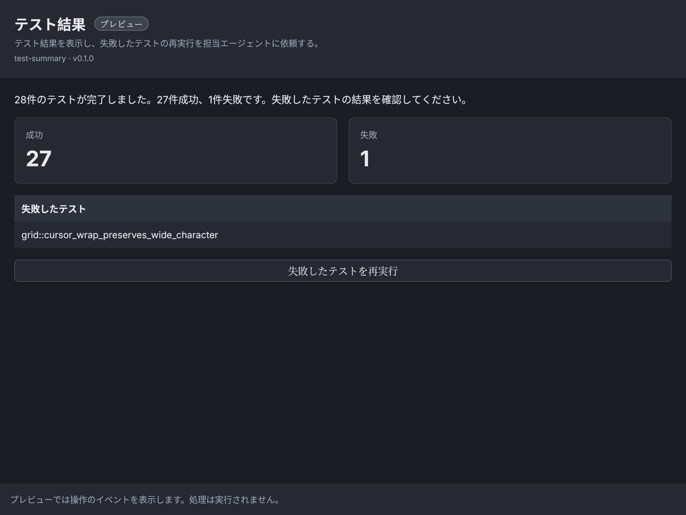

# Repository widgets

An agent can open a native Noa widget from a JSON definition, replace its data,
and consume button events. Share definitions in the repository; instances and
their pending events belong to the local Noa application. No new Rust crate or
application rebuild is needed for each definition.

The first API is `noa.widget/v1`. The renderer is the bundled `widget-host`
helper, using the same `noa-gpui` native stack as Noa's other widgets. The
manifest describes components and data bindings. It cannot execute a shell,
JavaScript, HTML, a repository binary, or an arbitrary network request.



The image above is an offline fixture preview, not a report of this
repository's test results.

## Try the included widget

For development, build both binaries from the Noa checkout:

```sh
cargo build -p noa
cargo build --manifest-path widgets/widget-host/Cargo.toml --locked
```

Use `target/debug/Noa` in place of `Noa` below if it is not installed. The helper
is found in the app bundle, Linux package, or its development build directory.
Debug builds also accept a `widget-host` next to `Noa`, for a shared
`CARGO_TARGET_DIR`. The helper is never resolved from a manifest or `PATH`.

Validation and fixture rendering do not connect to the control server:

```sh
Noa +ctl widget schema
Noa +ctl widget validate .noa-widgets/test-summary/widget.json
Noa +ctl widget validate .noa-widgets/test-summary/widget.json \
  --data-file .noa-widgets/test-summary/fixtures/normal.json
Noa +ctl widget preview .noa-widgets/test-summary/widget.json \
  --data-file .noa-widgets/test-summary/fixtures/normal.json \
  --snapshot /tmp/test-summary.png --size 960x720
```

Omit `--snapshot` to open an interactive preview. Preview buttons display their
event locally; they do not start an agent or perform the action. PNG rendering
uses the software renderer at 2× the requested logical size. Fonts come from
the system, so images are deterministic for a given font set.

The command palette's **Repository Widgets…** entry (`widget-host.open`) opens
the current worktree's catalog and previews. On macOS it also appears in the
View menu. The catalog works with `server-enable = false`.

## Share a definition

Put one package in `.noa-widgets/<id>/`:

| File | Purpose |
| --- | --- |
| `widget.json` | Required definition, schema, initial data and view |
| `README.md` | What the widget means and how the agent handles its actions |
| `fixtures/*.json` | Example data for validation and visual review |
| `assets/*` | Images the manifest declares in `assets` (PNG, JPEG or WebP) |

The directory name must match the manifest's `id`. IDs use lowercase ASCII
letters, digits and single hyphens, start with a letter, and are at most 64
characters. Commit the package to share it. `.noa/` is ignored local task
storage and is not the definition registry.

Discovery starts at the current Git worktree root and reads only that
worktree's `.noa-widgets`. Linked worktrees have separate registry contents
and instance identities, while their `repositoryId` identifies the common
Git directory. These IDs are local path identities, not portable package IDs
or authorization grants. Discovery rejects symlinked registry directories,
packages and manifests, non-regular inputs, oversized files and invalid
definitions. It does not execute repository hooks or a definition's code.

To generate a one-off widget without writing a shared package, pass the
definition as `--definition-file FILE` (or `-` for stdin) to `open`. It is
stored in the local instance snapshot, with `definitionSource: "inline"`;
the service does not write it into the repository. Promotion to a shared
package is a separate agent file edit and Git commit.

## Manifest contract

The complete working example is
[test-summary/widget.json](../.noa-widgets/test-summary/widget.json).
The top-level fields are listed below; `actions` may be omitted when empty
and `assets` when the widget has no images. All other fields are required.

| Field | Contract |
| --- | --- |
| `apiVersion` | Exactly `noa.widget/v1` |
| `id` | Package ID, independent of a runtime `instanceId` |
| `version` | Numeric `major.minor.patch` package version |
| `title`, `description` | Nonempty human/agent descriptions |
| `dataSchema` | Supported JSON Schema subset below |
| `initialData` | Complete initial data, validated against the schema and view |
| `view` | One root component with unique node IDs |
| `actions` | Array of uniquely named `agent-event` declarations; may be empty |
| `assets` | Optional map of asset ID to `{"path": "assets/<file>"}`; see [Packaged images](#packaged-images) |

Unknown fields, duplicate JSON object keys, unknown components/action kinds,
unsupported schema keywords and future API versions are errors. `widget
schema` prints a JSON Schema document for editor tooling; `widget validate`
also checks semantic rules such as pointer types, action references and
unique table row keys. Use validation as the authoritative check.

### Data and bindings

Every schema node declares one `type`: `object`, `array`, `string`, `integer`,
`number`, `boolean` or `null`. The supported constraints are `enum`, object
`properties` / `required` / boolean `additionalProperties`, array `items` /
`minItems` / `maxItems`, string `minLength` / `maxLength`, and numeric
`minimum` / `maximum`. This is deliberately a subset: no `$ref`, unions,
regular expressions, remote schemas or expression evaluation.

A bindable field is a literal or an RFC 6901 JSON pointer:

```json
{"source": "data", "pointer": "/summary"}
```

There is no interpolation such as `${...}`. Pointers must identify a declared
schema location and resolve in the current data with the component's expected
type. Supply complete data on each update; this API does not merge patches.

### Components

Every component requires `id` and `type`. Containers have `children` and may
set `gap` to `none`, `xs`, `sm`, `md` or `lg`.

| Component | Main fields |
| --- | --- |
| `column`, `row` | `children`, optional `gap` |
| `section` | `title`, `children`, optional `gap` |
| `text` | `text`, optional `tone` |
| `metric` | `label`, string or numeric `value` |
| `badge` | `text`, optional `tone` |
| `progress` | Numeric `value`, optional positive `max` (default 1) and `label` |
| `table` | Object-array `rows`, `rowKey` pointer, `columns` with `title` and row-relative `pointer` |
| `list` | Object-array `items`, `itemKey` pointer and row-relative `textPointer` |
| `button` | `label`, declared `action`, optional object `payload` (default `{}`) |
| `image` | Asset ID `src`, string `alt`, optional `size` or `width`/`height`, optional `shape` |

Tones are `default`, `muted`, `success`, `warning` and `error` where supported.
Table/list keys must exist and be unique in the supplied rows. Keep row IDs
stable when updating the same logical items.

### Packaged images

A widget shows only images committed in its own package. Declare each one
under `assets` and reference it by ID; there are no URLs, `data:` URIs,
arbitrary paths or network fetches.

```json
"assets": {
  "logo": {"path": "assets/logo.png"},
  "hero": {"path": "assets/hero.jpg"}
},
"view": {"type": "image", "id": "logo", "src": "logo", "alt": "Project logo", "size": "sm"}
```

Asset IDs follow the package ID rules. A path is relative to
`.noa-widgets/<id>/` and lies below its `assets/` directory (at most three
names deep). It cannot be absolute or contain `.`/`..`, hidden names or
backslashes. Every path component must be a real directory or a regular
file, never a symbolic link. The format is detected from the file's magic
bytes, not its extension: PNG, JPEG (baseline or progressive) or still WebP.
`widget validate` checks that each file exists and meets the format, size and
dimension limits, and lists the assets it read.

| Image field | Contract |
| --- | --- |
| `src` | Required. A declared asset ID, or a binding to a string schema whose `enum` lists only declared asset IDs |
| `alt` | Required bindable string (a literal has 1–500 characters); read by assistive technology and shown when the image cannot be drawn |
| `size` | `sm` (48), `md` (96, default) or `lg` (192 logical pixels), a square box |
| `width`, `height` | Explicit box in logical pixels, both together, integers 1–1024; not combined with `size` |
| `shape` | `square` (default) or `circle` |

The picture keeps its aspect ratio inside the box (fit, centered). A circle
is the centered square of the picture with a round mask; the toolkit has no
rounded clip, so the host bakes the mask into the uploaded pixels. If a
picture cannot be decoded, its `alt` text fills a box of the same size, so the
layout does not change. A data update can switch a bound `src` to another
declared asset; data cannot add images.

Assets are part of the pinned definition. A manifest with assets has a
definition digest that covers the canonical manifest and every asset's
sha256 content digest, so changing one image byte changes the definition.
Manifests without `assets` keep exactly their previous digest. Inline
definitions (`open --definition-file`) have no package directory, so a
manifest with `assets` is rejected there; commit the package and open it by
ID. The palette catalogue's preview windows show the `alt` text in place of
images; `widget preview` and live instances draw them.

### Actions

```json
{
  "id": "rerun-failed",
  "kind": "agent-event",
  "payloadSchema": {
    "type": "object",
    "properties": {},
    "additionalProperties": false
  }
}
```

The host sends an action ID, payload, request ID and the displayed data
revision over its private pipe. The service checks the pinned manifest,
payload schema and revision, then durably queues an event. A stale click is
rejected; it does not silently act on newer data. The agent decides what the
event means using the task's existing authority. A button label is not a
permission grant, and displaying a widget never grants command execution.

## Agent control loop

Managed instances require Noa's existing control server to be enabled and a
client with the required scope. See [the server runbook](runbooks/noa-server.md)
for configuring access. `schema`, `validate`, `preview`, and the palette
catalog are offline operations.

```sh
Noa +ctl widget list --repo .
Noa +ctl widget describe test-summary --repo .
Noa +ctl widget open test-summary --repo . --request-id test-run-42-open
```

Save the returned `instanceId` and `dataRevision` (initially 1). Use a fresh
request ID for each new operation; reuse the exact ID and payload when
retrying an operation whose result was lost. IDs can contain ASCII letters,
digits, `.`, `_`, `:`, and `-`, up to 128 bytes.

```sh
Noa +ctl widget get "$instance"
Noa +ctl widget set "$instance" --data-file result.json \
  --expected-revision 1 --request-id test-run-42-result
Noa +ctl widget events "$instance" --consumer test-run-42 --wait 30s
```

`set` is compare-and-swap: a mismatched revision changes nothing. Read the
latest snapshot, reconcile it, then submit a new operation. A successful
retry with the same request ID returns the original result before checking
the now-old revision. Reusing that ID with different data is a conflict.
An uncertain outcome requires an identical retry, not a fresh request ID.

`events` claims one consumer ID for the instance. Inside a recognized Noa
pane the CLI defaults to `pane:<pane-id>`; outside one, pass `--consumer`.
Use an explicit stable consumer ID if another process needs to take over
after a restart. It is a coordination identity, not an authentication token.

Events contain `eventId`, monotonic `seq`, `actionId`, `dataRevision`, and
`payload`. Delivery is **at least once**: process in order, record completion
using `eventId`, and only then acknowledge the highest contiguous sequence
successfully handled. Side effects need their own durable deduplication;
acknowledging an event does not make an external command exactly once.

```sh
Noa +ctl widget ack "$instance" --consumer test-run-42 \
  --through 3 --request-id test-run-42-ack-3
```

`--after N` pages through already delivered events. It cannot jump over an
undelivered event. The response includes `nextSeq`, `lastSeq`, `ackedThrough`
and `hasMore`. The default page size is 32 (maximum 64). `--wait` polls for up
to 300 seconds and returns immediately on an event or stopped instance.
This API does not wake or resume a sleeping agent automatically.

### Close, recover and clean up

```sh
Noa +ctl widget close "$instance" --request-id test-run-42-close
# Drain and acknowledge any remaining events before forgetting.
Noa +ctl widget forget "$instance"
```

Closing stops the host and retains the last data, definition and events.
Closing the owner pane also stops its hosts (`ownerExited`); closing the
native window yields `hostExited`. An instance without an owner remains
until its host closes or it is explicitly closed. On application restart,
previously open instances become `restored` snapshots. They are readable,
and their events can be acknowledged, but they do not relaunch a window or
an agent. Open a new instance to continue, optionally supplying the old data.

`forget` only removes a stopped instance with no pending events. It is
idempotent by instance ID and does not need `--request-id`. Forgetting also
removes its deduplication history: an old `open` request ID is no longer
reserved and must not be reused as a retry afterward. There is no automatic
expiry that silently discards unacknowledged events.

## Storage and process boundaries

`crates/noa-widget` owns validation and read-only discovery. `noa-app` owns a
single widget-service writer, which persists the complete state using a
temporary file, file sync, atomic rename and directory sync. States live
under the platform local data directory's `noa/widgets/` (`~/Library/Application
Support` on macOS; normally `~/.local/share` on Linux). They never contain a
control token and are not Git-shared. Treat widget data as local application
data: avoid copying credentials or secrets into it.

Each managed `widget-host` gets one private stdin/stdout JSON-lines channel.
It cannot name another instance, receive the global control token, or select
an executable. The service starts only Noa's registered helper. The host
pins the definition digest and accepts nondecreasing snapshots for that
instance. A managed host is never given a filesystem path: when an instance
opens, the service reads and verifies the package's assets and sends their
bytes over the same pipe, in base64 chunks before the first snapshot. The
host checks each asset against its content digest and the snapshot's
definition digest. Asset bytes are not stored in the instance state, which
keeps only their digests; a restored instance does not reopen a window. Editing a repository manifest does not alter an existing instance;
close and reopen to use the new definition.

Public `noa.widget.*` calls retain the existing **trusted-controller**
noa-server model. `list`, `describe` and `get` need `read`; `open`, `set`,
`events`, `ack`, `close` and `forget` need `control`. Read scope can therefore
read widget data, and control scope can operate other instances. Repo paths,
pane IDs and consumer IDs are not per-repository access control. Do not
describe this release as a sandbox for untrusted controller clients.

## Limits and errors

| Resource | Limit |
| --- | ---: |
| Manifest / current data / action payload | 64 / 128 / 16 KiB |
| Schema/view depth / view nodes | 32 / 512 |
| Definitions per worktree | 128 |
| Rows per table or list | 1,000 |
| Expanded view items / displayed text | 8,192 / 512 KiB |
| Retained instances / simultaneously open instances | 64 / 16 |
| Pending events per instance / serialized event queue | 128 / 256 KiB |
| Mutation retry ledger / action retry ledger | 1,024 each while open |
| Persisted state per instance / private pipe line | 1 MiB / 256 KiB |
| Assets per package / bytes per asset / asset bytes per package | 16 / 512 KiB / 2 MiB |
| Asset dimensions / explicit image box | 2,048 × 2,048 px / 1,024 × 1,024 logical px |

An event queue at capacity rejects new clicks; consuming and acknowledging
events frees it. Retry ledgers are not silently evicted. At their lifetime
limit, close the instance, drain its events, and open another. Closing is
still allowed when the normal request ledger is full. `forget` recovers
retained-instance capacity after pending events have been handled.

Invalid definitions/data are rejected before becoming a new state. Revision,
consumer and request-ID conflicts return `WidgetConflict` (`-32019`);
missing instances return `WidgetNotFound` (`-32020`). Store, capacity, busy
and uncertain-outcome errors use the existing noa-server error categories.
The CLI exits nonzero on failure and reports what needs correction. Offline
`validate` returns JSON with `valid` and a diagnostic list on failure.

## Skills and extension points

`skills/noa-widgets` teaches the live control loop. `skills/noa-widget-creator`
teaches creating a definition, supplying fixtures, validating, previewing
and sharing it. The existing installer discovers both automatically:

```sh
scripts/install-agent-skill.sh --dir /path/to/project/.agents/skills
```

The MVP has a fixed component vocabulary and agent-event actions. It does
not implement embedded web content, custom plugins, network data sources,
automatic watchers, data migrations, hot reload, multiple event consumers,
or automatic agent resumption. New components belong in the shared
validator and host; new repository-specific views belong in manifests.

Tests and source locations are listed in [the feature map](feature-map.md).
