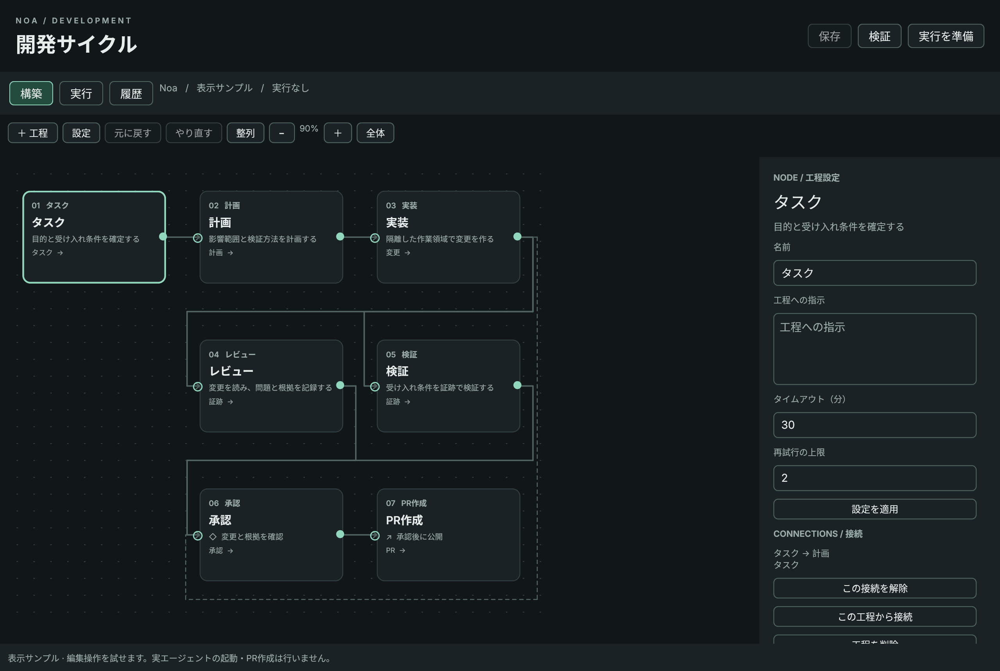
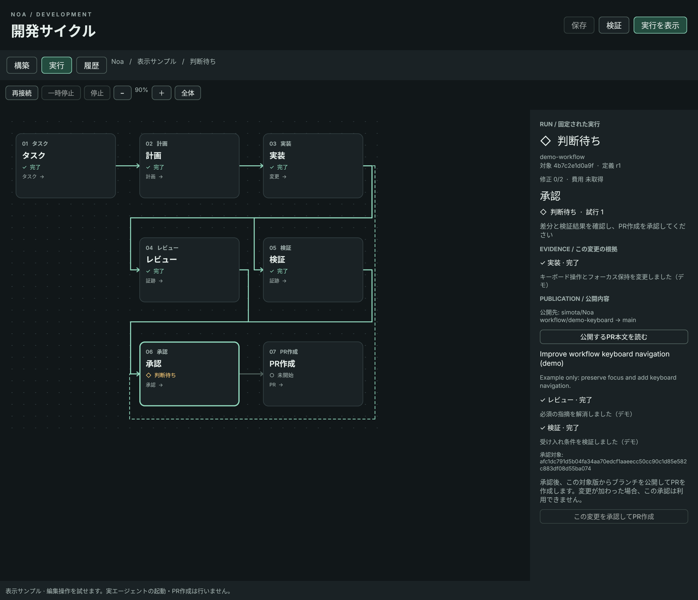
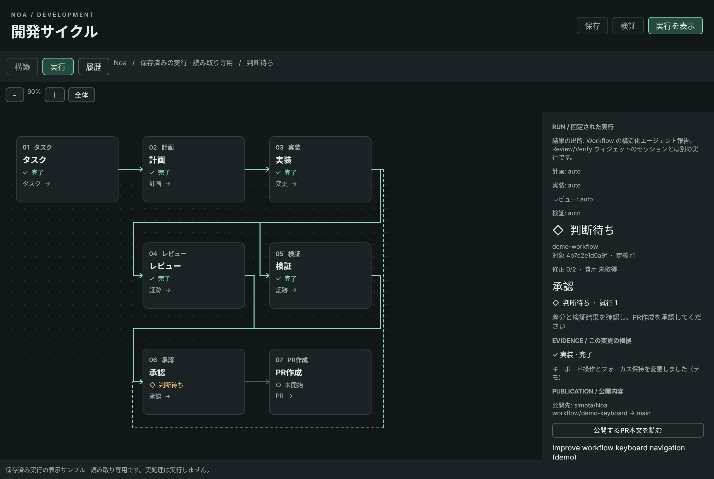
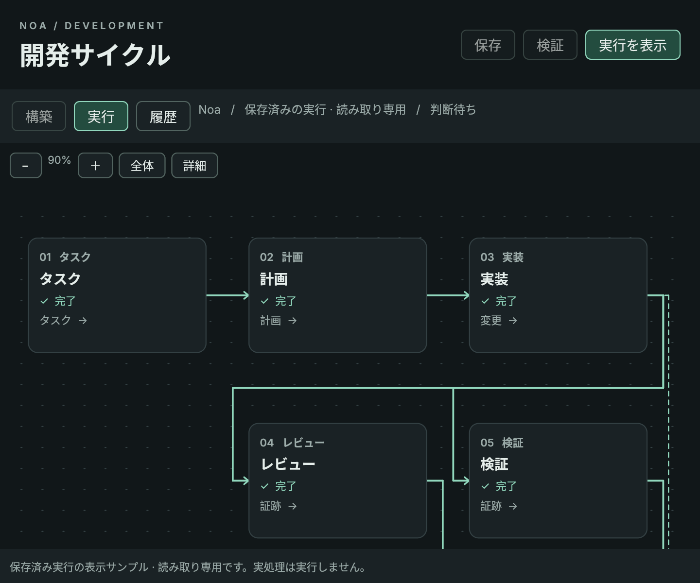

# Workflow

Workflow is Noa's native visual editor and runner for a development cycle. A graph describes the work, typed connections describe its inputs, and a saved run records which version of the graph and repository each result belongs to. The standard graph plans and implements a change, reviews and verifies that change in separate worktrees, waits for a person's approval, and creates a draft pull request.

Choose **Open Workflow** in Noa's command palette, or **Workflow** from the View menu on macOS. The application action is `workflow.open`; the helper is bundled as **Noa Workflow** on macOS and Linux. This editor is separate from the Board's read-only delegation visualization. Routine operation does not require entering terminal commands. The runner uses existing Noa agent panes, Git, and the GitHub CLI behind the interface; their installation, authentication, and permission configuration remain prerequisites for the stages that use them.

### Native previews

These screenshots are rendered by the native widget's software renderer from explicit demo fixtures; they do not represent a live agent run or a published PR.





Saved-run inspection uses the same read-only path as Tasks result links. The
following offline fixtures were rendered on Linux at 2× scale, at logical sizes
1280×860 and 720×600. The narrow graph scrolls vertically and its **詳細** button
opens the full-width inspector. These images do not represent a live agent run.





Reproduce these fixtures with `--demo=saved --snapshot=PATH.png` and
`--size=1280x860` or `--size=720x600`.

## Using a workflow

1. Open Workflow for a repository. The first saved definition is the standard development cycle.
2. Edit the graph, stage instructions, and execution limits. Connect compatible outputs and inputs. An incomplete draft can be saved; a run requires a valid graph.
3. Enter a concrete objective and start a run. The runner captures the saved definition and the repository's current commit and file changes. Subsequent edits to the draft apply to a later run.
4. Follow stage states and inspect their messages, artifacts, and evidence. An agent requesting input or permission remains a visible wait. An ordinary agent completion notification does not make a stage successful.
5. When Review and Verify have succeeded for the same change, inspect the change and evidence before approving publication. Approval belongs to that exact run, definition, target, and set of input artifacts.
6. Follow the draft PR result. If the server response is lost, reconcile the saved operation. An uncertain publication is not automatically submitted again.

The workflow can focus an underlying agent pane when direct inspection is useful. Explicit answers use Noa's guarded agent-input API; the runner does not automatically accept agent permission prompts. A worker pane is an implementation detail during normal progress, but it remains available for an exceptional situation the structured workflow cannot resolve.

### Editing and inspection

Select a stage to edit its title, instructions, timeout, and automatic retry count. Plan, Implement, Review, and Verify also offer an agent selector, an optional model name, and a provider-specific effort selector. Stages can be added, moved, or deleted, and connections can be removed independently. Connect an output to an input by dragging between ports or by selecting the two ports in order. The editor rejects incompatible types, self-connections, duplicates, and cycles at connection time. The definition validation view explains any remaining missing inputs or graph requirements before a run can start.

The editor provides undo, redo, automatic arrangement, zoom, and a fit-to-graph view. Keyboard actions use the platform command modifier: Command on macOS and Control on Linux.

| Action | Shortcut |
| --- | --- |
| Save the draft | Command/Control + S |
| Undo or redo a graph edit | Command/Control + Z; add Shift to redo |
| Move the focused stage | Arrow keys; add Shift for a larger step |
| Delete the focused stage | Delete or Backspace |
| Abandon a drag or pending connection | Escape |

Graph shortcuts do not replace text editing while a text field is focused. The execution view uses the run's frozen graph and exposes stage messages and artifact details. The history view displays the latest 500 run events; the persisted run retains its full bounded event history. Narrow windows switch between graph and details instead of compressing the inspector into an unusable column. Below 80% zoom, cards show a readable overview with the stage title and state; selecting a card opens its full details. Port click targets stay at least 32 logical points wide and high at every zoom level, and overview captions stay at least 11 points before the shared text-size preference is applied.

### Agent assignments and presets

Each agent stage saves `agent.provider`, `agent.model`, and `agent.effort` in the workflow definition. Providers are `auto`, `codex`, `claude`, and `agy`. Leave model or effort blank to use that CLI's configured default; this records the default selection, not an independently verified model identity. Custom model names must be bounded plain words. Codex receives `-m` and `-c model_reasoning_effort=…`; Claude and agy receive `--model` and `--effort`. Effort choices follow the same provider capability table used by Noa's Review widget. Invalid names or unsupported effort levels are refused before a shell command is constructed. Agent permission options are not changed.

At run creation, `auto` is detected once and resolved to an explicit provider in the immutable run definition. Explicit assignments are preserved. Later retries, repair attempts, and reopening use this saved definition, even if the editor's draft changes. An explicitly selected provider must be installed and authenticated; selection is not a successful launch check.

Open the workflow settings inspector to save a named **担当構成** (assignment preset), then use **読み込む** to apply it to the draft. Presets retain each agent stage's ID and settings, including distinct assignments for multiple Review stages. They do not replace graph positions, instructions, or execution limits. A preset naming a missing or non-agent stage is refused. Saving the same name updates it; up to 32 presets are stored per repository in `agent-presets.json`. Save the edited workflow before starting a run with a loaded preset.

### Starting from Tasks and following results

Tasks can open Workflow with the selected task's title, body, repository, and stable task reference already filled in. This opens the new-run form; it does not start an agent or recover, retry, or advance a previous saved run. The handoff remains deferred even when it acquires ownership from another window. Closing it, refreshing, editing the graph, or a rejected start does not release that gate. Review the objective and assignments, save any graph edits, then choose **このフローで開始**. The run freezes the originating task identity and the exact objective used at start. **Tasksで元タスクを開く** returns to the same task.

If an unfinished run already exists, the new task's form stays visible and its start action is disabled. **以前の実行を表示** opens that saved run separately; **以前の実行を再開** explicitly enables its recovery and scheduling. Its controls do not operate on the new task. The ordinary Workflow entry point keeps its existing automatic recovery behavior. A run already owned by another window can continue there; opening a handoff does not pause or start that other window.

The handoff command is `workflow --repo=PATH --task-origin=ABSOLUTE_JSON_PATH`. The version-1 handoff contains `schema_version`, `repo`, `task` (the Tasks `--select` value), `task_key` (the serialized stable Tasks reference), `title`, and `objective`. The reader refuses symlinks, a repository mismatch, an invalid task-reference shape or mismatched return selector, unsupported versions, files larger than 128 KiB, and objectives larger than 64 KiB. Opening the handoff never executes its contents as a command.

After committing run state, Workflow writes a derived reference under `<Noa data directory>/tasks/<Tasks repository key>/workflow-results/<run-id>.json`. The reference includes the source task, run ID, state, exact target digest, definition digest, progress summary, last-update time, and a PR URL only when a publication result has been accepted. Its `source` is `workflow_agent_reports`. Tasks displays these as Workflow results, separate from Review or Verify widget sessions. This link does not imply those existing sessions ran, nor does it promote a result for an older target to evidence for a new change.

`workflow --repo=PATH --run=RUN_ID` opens the saved run read-only without starting the runner or connecting to agents. It is the destination of the result link in Tasks. The run snapshot remains available after a later run starts. If a derived reference cannot be written, the committed run remains authoritative and the UI reports the projection failure.

The saved-run window shows its frozen graph, stage details, history, and evidence. Editing, approval, retries, and agent input are unavailable there. A draft answer in a live window belongs to the displayed run, stage attempt, and agent input-report sequence; a different run, attempt, or question clears that draft. The runner rejects an answer addressed to an attempt that is no longer waiting for that input, and the adapter checks the sequence against the latest agent report before sending. A restored wait without an input sequence offers reconciliation rather than an answer field until the live request has been observed again.

### Shared display preferences

Use **ウィジェットの表示設定** from Noa's command palette, or run any native widget with `--widget-settings`, to choose system/light/dark appearance, 100/115/130/150% body and input text size, and standard/compact whitespace. Labels, buttons and editable text use the selected scale; auxiliary menus, segmented controls and tags retain GPUI's default size. The preview shows the chosen text size and appearance. Save and reopen the widgets to apply the preference. Density changes whitespace independently from text size and the Workflow port-target minimum.

The shared file is `<Noa data directory>/widget-appearance.json`. Offline demo/snapshot invocations and tests use defaults unless `NOA_WIDGET_APPEARANCE_FILE` explicitly selects a settings file, allowing repeatable screenshots of different display preferences.

### Reading changes and evidence

Select a completed stage, or the waiting Approval stage, to open its reports and evidence inside the workflow. **構造化された報告を読む** opens the structured report. **根拠を読む** opens an evidence file, including the captured `changes.patch` for Implement, review findings, or verification logs. **公開するPR本文を読む** shows the prepared PR body. The viewer is read-only and supports text selection and copying; use **ワークフローへ戻る** or Escape to return to the graph.

Before displaying a file, the viewer reads its entire contents up to 8 MiB and verifies the recorded SHA-256. It refuses missing or changed files, symlinked paths, oversized files, and non-UTF-8 content. It displays at most 120,000 characters and marks truncation explicitly, after checking the full file rather than only the visible prefix. Control characters other than newline and tab, and bidirectional display controls, appear as visible `[U+XXXX]` notation. The stored evidence remains unchanged. A truncated preview is not a claim that the whole file has been reviewed.

Failed structured reports retain their evidence too. After a retry or repair, open it under **過去の試行**; its attempt number and target distinguish it from the current stage's results. A failed Review or Verify passes these reports and logs to the repair attempt as hash-checked local copies. Failure evidence remains a failed verdict and cannot satisfy an approval's successful-input requirements.

## Stage and connection contracts

| Stage | Required input | Output | Implemented behavior |
| --- | --- | --- | --- |
| Trigger | None | Task | Captures the person's objective as a local artifact. |
| Plan | One Task | Plan | Runs an agent in a separate worktree to write a plan and acceptance criteria. Project changes invalidate the result. |
| Implement | One Plan | Change | Runs the only implementation writer in the run's owned `noa-workflow/…` branch. The agent is instructed to commit the completed change and report its checks. |
| Review | One Change | Evidence | Runs a separate agent against the exact implementation target. It reports findings and must explicitly report that no blocking findings remain. Project changes invalidate the result. |
| Verify | One Change | Evidence | Runs a separate agent against the same target. At least one structured check, its argument vector, exit code, and nonempty log are required. Project changes invalidate the result. |
| Approval | One Change and evidence from both Review and Verify | Approval | Waits for a person's approval of the displayed target and evidence. Agents cannot complete this stage. |
| Pull Request | One Approval | Pull Request | Publishes the committed implementation branch and creates a draft GitHub PR, or reconciles an already attempted publication. |

Review and Verify are new structured-report stages. They do not embed or reuse the existing Review and Verify widget sessions. Their evidence is produced by the stage's agent and validated by the workflow adapter; the adapter does not independently rerun reported commands.

The definition must be a directed acyclic graph with exactly one Trigger and exactly one Implement stage. Every stage must be reachable from Trigger. Connections must reference existing stages, match their output and input types, and avoid duplicates. Each required Task, Plan, Change, or Approval input must occur exactly once. Every Approval needs evidence from at least one Review and at least one Verify. A graph without a PR stage can finish without publishing; removing a stage does not bypass the input requirements of stages that remain.

The default graph fans out from Implement to Review and Verify and joins their evidence at Approval. There is no arbitrary script stage, expression language, conditional branch, or user-authored graph cycle. Repair is a bounded runner operation, not a back edge in the graph.

If a graph has multiple Plan stages, all of them finish before Implement starts. Their worktrees use the initial target, so this barrier prevents an independent Plan from finishing against an obsolete target after implementation has changed it.

## Definitions, runs, and targets

The saved editor definition and the active run are separate values. Saving a changed definition advances its revision. Starting a run copies that definition and its digest into the run, along with the objective and canonical repository path. A draft edit cannot change the topology, instructions, or limits of a run already in progress.

A target consists of:

- The base commit captured at run start.
- The current implementation HEAD commit.
- A SHA-256 digest of the tracked delta against HEAD and the names, contents, and file modes of untracked, nonignored files.

The implementation stage can produce a new target. Its dependent results and approvals are then invalidated. Review and Verify receive separate detached worktrees containing the same commit, tracked delta, and untracked files. Their own project files must still match the target when the report is accepted. The runner retains old attempts rather than treating their evidence as evidence for the new target.

The source repository is not reset or edited by the workflow's Git adapter. Worktree preparation never removes an existing worktree or resets its contents. Implementation and validation worktrees remain on disk after the run. The application must be able to create worktrees in the repository's shared Git directory.

Snapshot support currently requires UTF-8 paths and bounds the captured delta plus untracked content to 64 MiB. Symlinked untracked files cannot be read as regular snapshot files. Ignored files are not copied. Only `.noa/workflow/` is reserved for workflow requests and results and excluded from the target delta; other `.noa` content is treated as ordinary project content. Tracked files in the reserved directory cause an explicit error instead of being silently omitted. Dependencies, ignored build inputs, or local configuration needed by verification must therefore be available independently in the new worktree. Worktrees isolate changes; they are not a security sandbox for an agent or a test command.

Snapshot patches and committed evidence use fixed, uncolored Git patch syntax regardless of color, prefix, or submodule display preferences. Submodule changes are always detected; a preference to hide them cannot make a changed target appear clean. Repository and Git-directory paths retain trailing whitespace when resolved.

After the implementation worker has stopped, the runner captures a Git patch between the fixed starting base SHA and the implementation's target HEAD SHA. This `changes.patch` is an additional Change evidence item with source `captured_git_diff`, scope `committed_changes`, both commit IDs, byte count, and a SHA-256 hash. Git produces it with external diff programs and text conversion disabled, and with binary-patch support. The patch is bounded to 8 MiB. Capture failure or an oversized patch preserves the implementation result as Uncertain and requires explicit reconciliation; it does not silently advance or restart the writer.

This patch shows committed changes made after the run's starting commit. Uncommitted changes are bound separately by the target digest and are outside the patch. Existing commits already present at run start are outside it too. A local-only run can retain a dirty target, while publication still requires a clean, committed implementation.

## States, retries, and limits

| State | Meaning |
| --- | --- |
| Pending | The stage has not started, or a confirmed failed attempt has been reset for retry. |
| Running | A request has been durably scheduled or an existing worker is observed running. |
| Waiting | A person, an agent input request, an approval, or another explicit condition is needed. |
| Uncertain | The runner cannot establish the outcome of a possibly executed operation. It must observe or reconcile before another attempt. |
| Succeeded | The stage's required artifact has been accepted for its target; a successful approval was given by a person. |
| Failed | Failure is established. Its message and attempt record remain available. |
| Paused | The run is not scheduling new stages. Existing work can still be running. |
| Canceled | A stage did not start, or the adapter confirmed the requested stop. An external publication is not undone. |

**Pause** stops new scheduling. It does not suspend operating-system processes or discard results that arrive from an existing worker. **Resume** clears the scheduling pause and reconciles uncertain attempts. **Cancel** requests that active workers stop and prevents pending work from starting. A lost stop acknowledgement remains uncertain until observed; a possibly published PR cannot be labeled canceled merely because cancellation was requested.

The server's `-32009` (`OutcomeUnknown`) response also requires reconciliation: a worker can still start after the spawn request times out. Workflow keeps that attempt uncertain instead of making it retryable. If cancellation is requested before the worker has been observed, an empty pane listing does not confirm cancellation. The saved cancellation intent remains active so a worker discovered later is stopped before the attempt is marked canceled.

Transient failures explicitly marked retryable can be retried automatically, with exponential delay and a per-stage bound. A failed stage can also be retried by a person after all active or uncertain workers have been resolved. A retry invalidates its descendants. PR operations never use automatic retry; a manual PR retry requires a failure known to have occurred before publication could begin.

When the only failures are in Review or Verify, the engine can automatically repair after other workers have stopped. It collects the failure messages as repair feedback, resets Implement, invalidates downstream evidence and approval, and runs the new change through validation again. The repair count is bounded. An explicit retry of a confirmed failed implementation can adopt its partial changes as the next attempt's target, preserving the original base commit. The adapter first checks the saved receipt, repository identity, and absence of a surviving writer pane. It does not adopt an uncertain attempt's partial result or reset those files silently.

| Limit | Default | Accepted definition range or behavior |
| --- | --- | --- |
| Stages | 7 | 1–64; the graph rules still apply. |
| Connections | 8 | At most 256. |
| Concurrent active stages | 2 | 1–8. There is still only one implementation writer. |
| Stage response timeout | 30 minutes | Greater than zero, at most 24 hours. A timed-out running attempt is automatically reconciled once, not presumed unexecuted. A running reply retains its original start time without retriggering that deadline. |
| Automatic retries per stage | 2 | 0–5. This bounds automatic retries, not a person's later retry decision. |
| Repair attempts per run | 2 | 0–10. |
| Total elapsed run time | 90 minutes | Greater than zero, at most 24 hours. Paused and waiting time still counts. |
| Observed cost threshold | Unset | Optional integer in millionths of a US dollar. Unknown cost is a separate value, not zero. |
| Allow unknown cost | Yes | With a cost threshold and this option disabled, an unknown-cost run does not start new stages. |
| Recorded events | At most 20,000 | Further transitions fail once this bound is reached. |

A total-duration or observed-cost limit stops new work and requests worker cancellation. This is stronger than an ordinary pause and can cancel stages that have not started. Resume rejects a run whose duration or observed cost limit has been reached; inspect its results and start a new run after resolving remaining workers. These limits cannot guarantee a hard billing ceiling for external agents. The current adapters do not supply cost telemetry, so live cost remains unknown. A strict cost configuration consequently prevents progress until a cost-reporting backend is available.

## Approval and publication

Approval is available only after the required predecessors have succeeded and their artifacts describe the current target. Its digest binds the run ID, definition digest, approval-stage ID, target, and hashes of all incoming artifacts. For a graph containing a PR stage, the Change artifact includes the prepared publication: GitHub repository, exact push URL, head and base branches, title, body, operation marker, and target. Those values are therefore part of the approval and are copied into its artifact. Before accepting an approval, the runner rereads saved report and evidence files and compares their hashes, then rechecks the implementation target. A changed report, evidence file, commit, or tracked/untracked delta prevents stale approval from being used.

The current publication adapter supports an `origin` URL in either `https://github.com/OWNER/REPOSITORY` or `git@github.com:OWNER/REPOSITORY` form, with an optional `.git` suffix. Embedded credentials and other hosts are refused. The fetch URL and resolved push URL must identify the same GitHub repository. It resolves the repository's default branch through `gh`, requires a clean, committed target on a `noa-workflow/…` branch, performs a normal push of the approved commit SHA to the approved URL, and creates a **draft** PR. It does not force-push, merge, delete branches, or delete worktrees. The objective supplies the PR title and body; local evidence files are not uploaded automatically.

Publication is prepared after the implementation report is accepted and its worker has stopped. This preparation reads GitHub repository metadata without pushing or creating a PR. If preparation cannot finish, the saved implementation remains uncertain and can be reconciled without respawning its writer. Review the displayed destination, branches, title, and body as well as the code and evidence before approving. Publication uses the approved values and rechecks the current origin, push URL, branch, and target; it does not silently resolve a different destination after approval. A graph with no PR stage skips publication preparation and does not need GitHub configuration. Editing the generated publication text separately from the objective is not implemented.

Publication preparation also uses GitHub's read-only comparison API to confirm that the run's starting base SHA is the same as, or an ancestor of, the destination's default branch. It repeats that check against the approved base branch before a new push when no matching PR already exists. This prevents pre-existing, unmerged feature-branch commits from being published outside the captured starting-SHA-to-target-SHA patch. If GitHub cannot establish that relationship, publication preparation or the attempted publication remains Uncertain with an explanation, preserving the completed implementation. Arbitrary publication of existing feature-branch commits is outside this MVP. Start a publishing run from a commit already contained in the destination's default branch, or use a graph without a PR stage; local-only flows do not have this publication restriction.

Before creating a PR, the adapter looks for the saved request marker on the expected head and base branches. Reconciliation requires a matching marker, head branch, head commit, repository, and PR URL. A conflicting PR or more than one match is an error. After a lost push or PR response, an absent PR is still an uncertain result: the runner does not infer that it is safe to create another one. Reopening or explicitly reconciling observes the saved operation rather than replaying publication.

## Persistence and recovery

Workflow state is local to the operating-system user and canonical repository path. Its root is `<Noa data directory>/workflows/<SHA-256 of canonical repository path>/`. The Noa data directory is `~/Library/Application Support/noa` on macOS and the platform data directory's `noa` folder on Linux, normally `$XDG_DATA_HOME/noa` or `~/.local/share/noa`.

The principal files are:

| Relative path | Contents |
| --- | --- |
| `workflow.json` | A checksummed envelope containing the current definition, store version, and current run with its events and attempt history. |
| `workflow.lock` | File lock used while reading or atomically replacing the snapshot. |
| `runner.lock` | Lifetime lease allowing one controlling runner for this repository's state directory. Other open windows observe the saved state. |
| `runs/<run-id>/run.json` | Read-only projection of each committed run state, retained after later runs start. |
| `agent-presets.json` | Up to 32 named stage-assignment presets, separate from the graph. |
| `runs/<run-id>/jobs/<node-id>-<attempt>/receipt.json` | Adapter identity, dispatch phase, worktree, pane reference, and accepted outcome for that attempt. |
| `runs/<run-id>/jobs/<implement-id>-<attempt>/changes.patch` | Runner-captured committed diff from the starting base SHA to the implementation target HEAD SHA. |
| `runs/<run-id>/implementation/` | The implementation worktree, reused for bounded repairs. |
| `runs/<run-id>/<node-id>-<attempt>/` | Detached worktrees for other agent stages. |
| `<stage worktree>/.noa/workflow/<node-id>-<attempt>/` | Request, structured result, local copies of input artifacts, and evidence files. |

The state store uses one atomic JSON snapshot, not an append-only JSONL journal. Run events have contiguous sequence numbers inside that snapshot. A save acquires an exclusive file lock, checks the expected store version, writes and syncs a new file, atomically renames it, and syncs the containing directory. A stale editor or writer receives a conflict instead of overwriting newer state. The store revision is distinct from the definition revision: recording execution progress also advances the store version.

Malformed JSON, unsupported schema versions, a checksum mismatch, or an invalid saved run prevents loading or overwriting the existing snapshot. The store refuses symlinked state/lock files and uses private file permissions for newly created state. The checksums detect changed content; they are not signatures or encryption. The state snapshot is bounded to 32 MiB.

The runner persists a model transition before dispatching its effects. Each adapter also saves its intent before spawning a worker or publishing a PR. Accepted agent results enter a durable finishing phase before the worker pane is closed, allowing reopening to complete that acknowledgement. Existing workers are matched using both their saved workflow label and canonical working directory; duplicate labels or mismatched directories stop automatic operation.

On reopening, active attempts are reconciled against their receipts and existing panes or PRs. Missing receipts, a crash during preparation, or missing workers can remain uncertain. The runner deliberately does not reconstruct and resend a possibly executed request. Some of these cases require inspection and a new run; recovery does not guarantee forward progress from every partial external operation.

### Closing and reopening the window

Closing the window sends a detach request through the same ordered queue as its actions. A Start, approval, or other action submitted before the close is processed before the runner decides whether it can exit. The helper continues autonomous work and scheduled retries, retains its controller lease, and waits for its runner thread to finish. It can exit when no autonomous work remains, such as an approval/input wait or an unresolved result. It does not drop a just-submitted action based on an older displayed state.

Reopening while that helper still owns the lease opens a **read-only observer** of the same saved run. The window identifies this monitoring state and keeps controller actions, including Save, Start, approval, and cancellation, disabled. It does not collect those actions into a queue to execute later. Local inspection and draft editing do not take over the other runner's work.

The observer checks persisted updates approximately once a second. It reads the atomically replaced snapshot without taking the writer's state lock, while retaining checksum and saved-run validation. When the previous controller releases its lease, the observer acquires it, reloads the current saved state, reconciles active attempts, and becomes the controller. Actions become available only after that handoff; an approval or other decision still requires an explicit action. If the original controlling window remains open, it retains its lease even after the run stops, so another window continues observing until that controller closes. Only an actual lease conflict enters observer mode; invalid paths, permission failures, and corrupt state remain errors.

The scheduler remains part of the Workflow helper process, not an independent system service. Killing that process stops scheduling; existing Noa agent panes may continue and need reconciliation on reopening. A persistence failure stops new adapter effects. Restore access to the state directory and reopen before continuing.

## Backend contracts

The implementation separates four concerns:

- `model.rs` defines typed graphs, artifact identities, run states, and limits.
- `engine.rs` is a deterministic transition engine. Inputs produce a candidate state and explicit effects. Invalid transitions leave the previous state unchanged.
- `store.rs` saves the definition and run with an optimistic version check and atomic replacement.
- `runner.rs` persists transitions, dispatches effects through `adapters`, and publishes views to the GUI from a background thread.

The GUI sends intents such as Save, Start, Pause, Resume, Cancel, Approve, Retry, Reconcile, and an explicit agent answer. Save includes the view's expected store version; Approve includes the digest the person reviewed. A view's `can_control` flag distinguishes a controller from a read-only observer; mutation intents are refused while observing rather than saved for later dispatch. Rendering and agent execution do not share the UI event loop.

### Structured agent reports

Every Plan, Implement, Review, and Verify attempt receives a request file containing its objective, instructions, input artifacts, exact target, and required report identity. The agent must atomically write UTF-8 `result.json` with the exact schema. Unknown fields are rejected. For example, a Verify report has this shape; all identity values must come from that attempt's request:

```json
{
  "schema_version": 1,
  "run_id": "run-EXAMPLE",
  "node_id": "verify",
  "attempt": 1,
  "request_id": "run-EXAMPLE-verify-1",
  "target_digest": "COPY_THE_TARGET_DIGEST_FROM_THE_REQUEST",
  "passed": true,
  "summary": "The required behavior and project tests passed.",
  "files": [{ "path": "verification.md" }],
  "checks": [
    {
      "criterion": "The relevant project tests pass",
      "command": ["cargo", "test", "-p", "example"],
      "exit_code": 0,
      "log": "tests.log"
    }
  ]
}
```

The adapter requires a nonempty summary, 1–32 evidence files, and at most 64 checks. Verify requires at least one check. A passing report cannot contain a nonzero check exit code. Agent-reported evidence paths must remain relative to the result directory, cannot traverse parents or symlinks, and must name nonempty regular files. Reports are bounded to 1 MiB; each evidence file is bounded to 8 MiB. The report must be stable across observations, and the agent must report completion or exit successfully. The runner then confirms that its pane has stopped and performs the final target and evidence checks, so a write between a completion notification and pane closure cannot become accepted evidence. Reports and evidence are stored with SHA-256 hashes and copied locally for downstream stages. The runner-captured Git patch is an additional evidence item stored beside the durable attempt receipt, outside the agent's report directory.

These validations bind an agent's assertion to its attempt and files. They do not establish that an agent actually ran the command it reports or that its criteria are sufficient. Review remains necessary for the quality of the plan, coverage, findings, and claimed evidence. An agent notification, a zero process exit code without a report, or an empty log cannot substitute for the report contract.

### Noa and external services

The live adapter requires a running Noa server at version 0.9.13 or later, its `boardTab` capability, and granted `read`, `control`, and `input` scopes. It does not fall back to unguarded terminal injection on an older server. Worker commands use a fixed allowlist of supported agent executables; prompt text is passed as a quoted environment argument rather than interpolated into shell syntax. The existing agent's permission model remains in effect.

Git and GitHub operations use argument arrays. Workflow-owned Git operations disable hooks and clear inherited `GIT_*` overrides. PR operations use the existing `gh` authentication, fix the host to `github.com`, and disable interactive CLI prompts. GitHub subprocesses have bounded waits, but the runner is not a process supervisor for every descendant an agent or project check may create.

## Configuration and privacy

Enable the existing Noa server with the minimum scopes required by Workflow in Noa's configuration:

```ini
server-enable = true
server-scopes = read,control,input
```

The existing defaults use loopback port `61771`. Workflow reads the normal Noa configuration and either its explicitly configured server token or the existing auto-provisioned token file. It does not require `attach`. See [Configuration](CONFIGURATION.md) and the [server runbook](runbooks/noa-server.md) for the server's configuration and token behavior.

Install and authenticate a supported agent and make it available in the login shell used by Noa. For stages set to `auto`, the runner probes `codex`, `claude`, and `agy` in that order once at run creation and freezes the first available provider. Explicit per-stage choices override automatic detection. Install and authenticate GitHub CLI before using publication and configure a supported `origin` remote. These setup tools are not part of the daily GUI workflow. There is no separate Workflow service, database, or account to configure.

The launcher supplies `--repo=DIR` to the native helper. Developers may invoke the helper with that argument for diagnosis; users can open it from Noa. Run limits and node instructions belong to the saved definition, rather than a separate global Workflow configuration file.

For offline UI inspection, the helper accepts `--demo`, `--demo=approval`, `--demo=failed`, and `--demo=saved`. The saved-run demo uses the same read-only display path as `--run`. `--snapshot=PATH.png` is available only with a demo, with an optional `--size=WIDTHxHEIGHT`; it cannot be combined with a live repository. Demos never spawn agents or publish changes.

Objectives, instructions, repository paths, artifact summaries, logs, reports, and local copies of changed files are retained in the state and worktrees. These are not automatically encrypted, redacted, expired, or synchronized. Agent prompts and repository content are processed according to the selected agent's own service and authentication configuration. Publishing sends the branch and PR text to the configured GitHub repository. The workflow does not upload its local evidence files as PR attachments.

Treat agent output, repository instructions, and test commands according to the same trust model as a directly launched agent. The instructions to avoid publishing and to stay within the worktree are part of the agent request, not an operating-system access boundary. Do not put secrets in an objective or report unless they are appropriate for the selected agent and for the local retention described above.

## Operational runbook

| Situation | Action and expected behavior |
| --- | --- |
| Noa is disconnected or scopes are missing | Check that Noa is running with the server enabled and `read,control,input` granted. Reconnect or refresh after fixing configuration. Do not start a second worker to compensate for a lost acknowledgement. |
| Agent waits for input or permission | Read the request, answer explicitly through the workflow where supported, or focus the existing agent pane. An uncertain answer is not automatically replayed. |
| Agent finished but the stage is waiting | Inspect its request and expected `result.json`. A missing report is an unmet contract, not success. Keep the worktree and receipt for diagnosis. |
| Report is rejected | Check the exact run/node/attempt/request/target identity, relative evidence paths, nonempty files, check exit codes, and whether project files changed in a read-only stage. Inspect the failed attempt before retrying. |
| Review or Verify fails | Inspect the findings and logs. The bounded repair loop may already be running; after its limit, resolve the remaining work deliberately. Old evidence is invalidated when implementation restarts. |
| Approval is refused after inspection | Reload the current target and evidence. A changed target or report requires fresh validation and approval; do not modify the stored digest to bypass the check. |
| An evidence preview is refused or truncated | Read the stated reason. A hash mismatch invalidates that file as previously accepted evidence; non-UTF-8 and oversized files cannot be shown by this text viewer. Truncation limits the displayed text, while the full file hash was checked. Do not treat an unread remainder as reviewed. |
| Captured diff or publication preparation remains uncertain | Inspect the explanation and reconcile after resolving the cause. The implementation has been retained and its writer is not restarted. A starting commit that is not contained in the destination's default branch is outside the publishing scope of this MVP; use an appropriate starting commit or a local-only flow. |
| PR result is uncertain | Reconcile the saved operation. Check the intended repository, branch, commit, and marker if manual inspection is necessary. An absent match does not authorize automatic recreation. |
| The editor reports a version conflict | Keep the intended edit, refresh the current saved definition, and reapply the edit against that version. Execution progress may have advanced the store version even when the graph itself is unchanged. |
| Another runner holds the lease | The new window observes the persisted run without sending control actions. Wait for the background controller to reach a stopping point, or close the original controlling window if it is still open. The observer acquires control after the lease is released. A lock file's presence alone is not a stale lock: the active file lock is what matters. |
| Persistence failed | Stop initiating operations, restore disk space or access, and reopen. Existing workers may still be running; reopening reconciles them before further scheduling. |
| State is corrupt or its schema is unsupported | Preserve the original state directory for diagnosis. Do not overwrite it or delete receipts to make a run appear new. Recovery from a backup or an explicit new run requires resolving any surviving workers and publications first. |
| A run was paused or its window closed | Reopen and inspect the existing run. The window may initially observe a helper that is still working. Ordinary pause does not stop workers, and closing a window or losing a helper process does not establish their outcome. |
| Worktrees need cleanup | First resolve or stop active and uncertain attempts and retain evidence you need. Use Git-aware worktree cleanup deliberately; this release does not automatically prune worktrees or history. |

## Implemented scope and remaining work

This release includes the native visual definition editor, typed DAG validation, immutable run definitions, separate worktrees, structured agent reports, a hash-checked read-only evidence viewer, runner-captured committed diffs, bounded retry and repair, exact-target change/evidence approval, draft PR publication and reconciliation, and local versioned persistence. The Board remains a separate view of existing delegation relationships.

The following are not implemented contracts: an always-running scheduler service; arbitrary commands or third-party stage plugins; conditional or looping graph syntax; independent execution of verification commands by the runner; cost collection or a hard spending guarantee; automatic deletion or retention policies; remote/multi-user workflow storage; GitHub Enterprise or non-GitHub publication; arbitrary publication of pre-existing, unmerged feature-branch commits; separate editing of the prepared PR title and body; and automatic recovery by resending every interrupted operation.

The offline demo fixtures exercise the same state engine without dispatching live adapters. They are examples, not evidence that Noa, an agent, or GitHub has completed work. Unit tests cover graph validation, engine transitions, approval invalidation, bounded repairs, state conflicts, corruption handling, and adapter input boundaries. End-to-end live agent execution, process interruption, and platform GUI behavior still need their own environment-specific verification.
