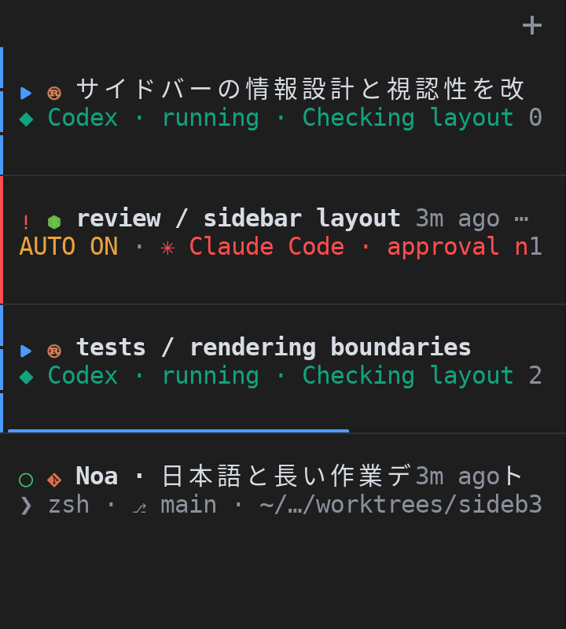

# Agent sidebar rendering comparison

These images show synthetic sessions rendered by Noa's production sidebar text
renderer and wgpu compositor. They contain no captured terminal-session data.
They are offscreen rendering evidence, not screenshots of a running native
window or a substitute for manual GUI verification.

## Capture conditions

- Before: `681e0019e8cbe65adf5e632790b9fc8a81b96a62`.
- After: `d8b81a3ad83f9cef7d44b8d9aaa283cb1e2ece75`.
- Identical synthetic session data and startup settings in both versions.
- Linux, DejaVu Sans Mono 11.5 pt, display scale 2, dark theme.
- Measured font cell size: 18 × 36 physical pixels.
- Default terminal padding: top 0, right 16, bottom 16, left 24 physical pixels.
  Before passes this padding to the sidebar. After uses the sidebar's dedicated
  zero padding, following each version's production code.
- Software Vulkan rendering through Mesa llvmpipe.
- Original PNG output, without image processing or retouching.

## Comparison

Widths below are logical pixels; PNG dimensions are physical pixels.

| Scenario | Before | After |
| --- | --- | --- |
| 360 px, 5 preview rows |  |  |
| 200 px, 5 preview rows |  |  |
| 360 px, no preview rows |  |  |

The fixture exercises selection, hover, an approval request, automatic approval,
progress, idle sessions, long Japanese titles, and long working directories.
The production `card_lines`, `emit_card_text`, `SidebarMetrics`, and
`draw_sidebar_band` functions produce the card content, geometry, and pixels.
The isolated capture harness does not change production code or dependencies.
