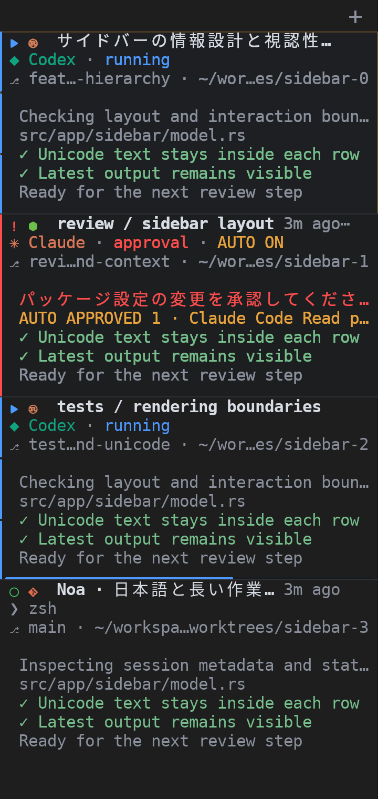
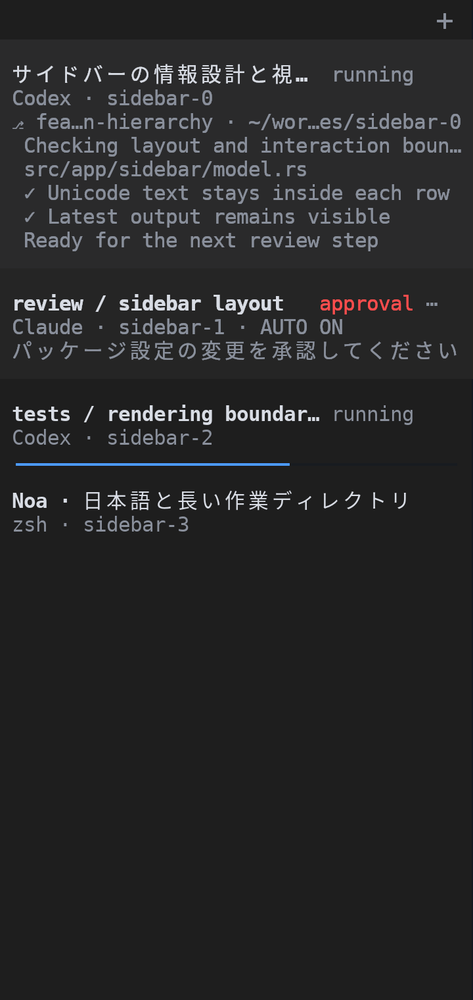
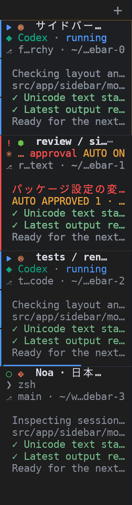
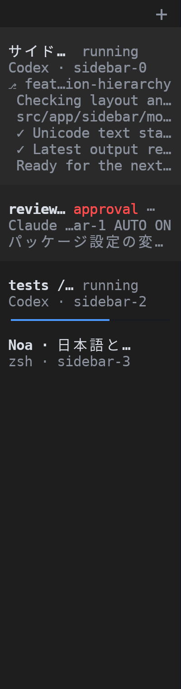
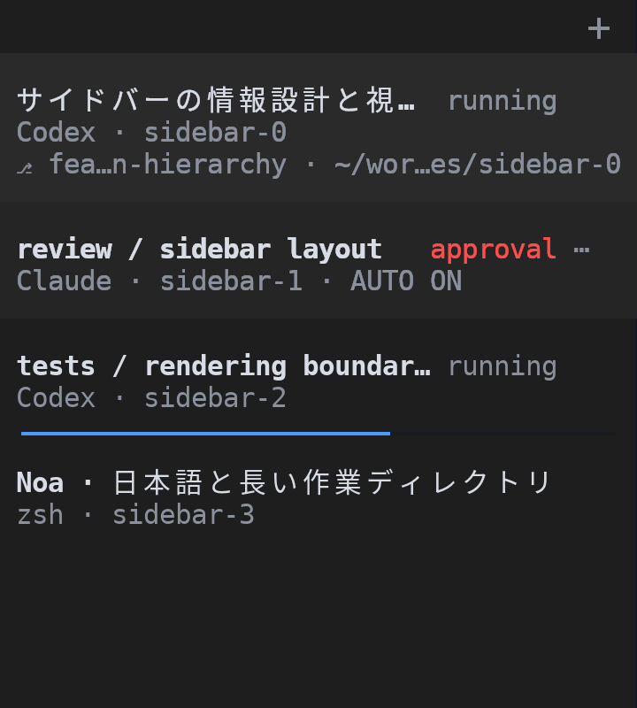

# Agent sidebar rendering comparison

These images compare the sidebar redesign with the previous revision of this
PR. The same synthetic sessions are rendered by Noa's production sidebar text
renderer and wgpu compositor. They contain no captured terminal-session data.
They are offscreen rendering evidence, not screenshots of a running native
window or a substitute for manual GUI verification.

## Capture conditions

- Before: `149718354c64f0e60a1e958acbf6b939d1a7f2c1` (previous PR revision).
- After: `2ccf8691a860f492e146b283986600a588363183` (sidebar redesign).
- Identical synthetic session data and startup settings in both versions.
- Linux, DejaVu Sans Mono 11.5 pt, display scale 2, dark theme.
- Measured font cell size: 18 × 36 physical pixels.
- Default terminal padding: top 0, right 16, bottom 16, left 24 physical pixels.
  Both versions use the sidebar's dedicated zero padding, independently of
  these terminal settings.
- Software Vulkan rendering through Mesa llvmpipe.
- Original PNG output, without image processing or retouching.

## Comparison

Viewport dimensions below are logical pixels. PNG dimensions are twice these
values on each axis. Each pair uses the same viewport and preview setting.

| Viewport | Preview limit | Before | After |
| --- | --- | --- | --- |
| 360 × 760 px | 5 rows |  |  |
| 200 × 760 px | 5 rows |  |  |
| 360 × 400 px | 0 rows |  |  |

## Session states and detail visibility

Both versions receive four sessions in the same order: a selected running Codex
session, a hovered Claude session requesting approval, another running Codex
session with 62% progress, and an idle shell. The data includes long Japanese
titles, long branches and working directories, automatic approval enabled on
the Claude session, an earlier approval audit entry, and five output rows.

In the redesign, the selected first card expands to show its working context
and up to five detail or output rows. Other running and idle cards use two
lines: title and state, then agent or process and working-directory name. The
unselected approval card adds one request-detail line when previews are
enabled; hovering it reveals the menu without expanding the card. Routine
status, metadata, and output use neutral colors, while the approval label and
actual progress bar retain their semantic colors.

With the preview limit set to zero, output rows and the approval-detail row are
hidden. The selected card keeps its working context; other cards remain compact.

The production `card_lines`, `emit_card_text`, `SidebarMetrics`, and
`draw_sidebar_band` functions produce the card content, geometry, and pixels.
The redesigned capture uses the production variable-height layout and texture
crop, including the selected, attention, and compact card modes.
The isolated capture harness does not change production code or dependencies.
