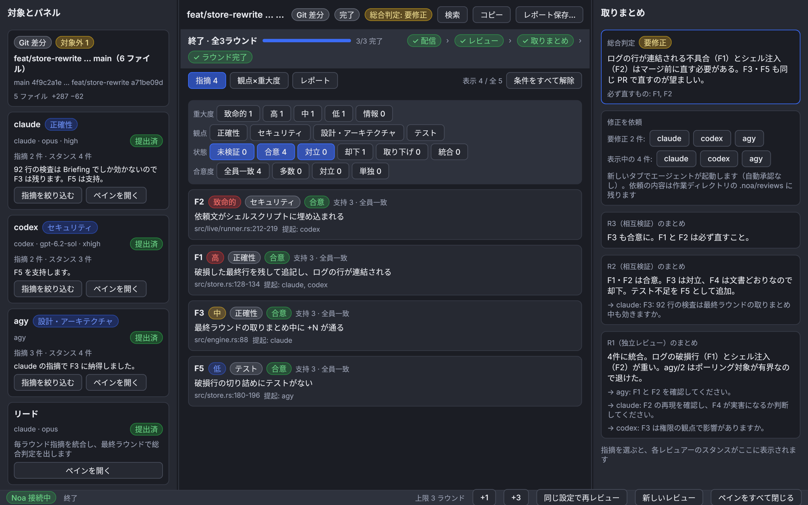
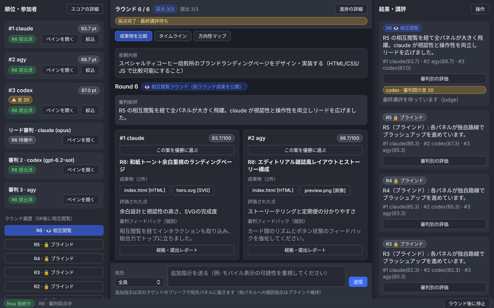

# ディスカッション・レビュー・コンペ・多角検証のUI

4つのウィジェットは、現在の状態、読むべき本文、次に進む操作を通常表示の中心に置く。内訳や履歴はその情報の近くで開き、コピー・保存・ラウンド追加などの補助操作は「操作」にまとめる。

## 共通の表示ルール

- 本文と見出しの文字サイズを確保し、識別子や補足は一段弱い表示にする。
- 成功状態や分類の強調を抑え、失敗、修正依頼、対立、一時停止など判断が必要な状態を見つけやすくする。
- 詳細を閉じても、失敗・修正依頼・再試行・次のラウンドへ進む操作を確認できる。
- タブは選択状態で表す。Enterの既定操作とタブ選択を分け、一時停止中は「次のラウンドへ」を既定操作にする。
- 表示更新や詳細の開閉で、入力中の文章、選択条件、詳細の開閉状態、キーボードフォーカスを保つ。
- 終了したセッションでは入力欄を隠し、結果の閲覧や次の作業に画面を使う。延長で再開した場合は入力欄を戻す。

## 各ウィジェットの構成

| ウィジェット | 通常表示の中心 | 必要なときに開く情報・操作 |
| --- | --- | --- |
| ディスカッション | 論点の状態と賛否の件数、発言本文、決定事項と次のアクション | 論点を選択すると参加者別の立場を表示。「操作」にコピー、議事録の書き出し、実装の依頼、ラウンド追加などを集約 |
| レビュー | 現在の進捗、重要度、指摘内容、対象箇所 | 進捗の内訳、観点・状態・合意状況の詳細フィルタ。適用中の絞り込みは閉じても概要を表示 |
| コンペ | 現在の順位と得点、成果物の比較、結果と講評、優勝案の採用 | 得点履歴、審判別の評価、採点根拠と提出レポート。比較ビューアー、保存、リマッチなどは「操作」から実行 |
| 多角検証（Verify） | 基準ごとの最新判定、検証者の結果、未解決の必須基準、引用された証跡 | 実行設定、検証者ごとの進捗、過去の判定。「操作」から保存や同じ設定での再検証を実行 |

ディスカッションの議事録は「決定事項 → 次のアクション → 対立点 → 未解決の問い」の順に表示する。タイムラインに投稿できない状態は通常の投稿待ちと区別し、「理由を確認」から説明を開ける。

レビューでは重要度のフィルタを常時表示する。指摘一覧は主張を中心にし、詳細な賛否や出所は選択中の指摘に表示する。合意に至っていない指摘の警告は選択前から残す。

コンペでは順位表と比較カードに同じ得点表記を使う。複数審判の平均値は小数を含めて揃え、審判間の得点差が大きい場合の警告は内訳を閉じても残す。長い講評をスクロールしても、優勝案の採用と「操作」の入口は見える位置に置く。

### 多角検証の流れ

開始画面には対象、依頼、受け入れ基準を表示する。判定役・検証者・手法、隔離、ラウンド上限は「詳細設定」で変更でき、閉じている間も設定の概要と「自動で割り当て」を表示する。開閉で入力や選択を失わない。

基準の確認中は、文章・検証方法・優先度を編集して、そのまま「検証を開始」できる。開始時に未保存の編集をまとめて検証し、基準の更新と確定を一度に記録する。不正な編集があれば理由を表示し、入力を残したまま開始を止める。

結果の表には「必須・未解決」「不合格」「再実行の相違」「実行不能」「未実施」の絞り込みがある。基準を選ぶと詳細、検証者の結果を選ぶとその結果が引用した証跡を表示する。証跡から表に戻っても絞り込みを保つ。基準の詳細は最新判定と根拠を先に示し、過去の判定は「判定の履歴」で開く。進捗の内訳や「操作」を閉じても、問題の発生と次に進む操作を確認できる。

「同じ設定で再検証」は、基準のID、順序、文章、検証方法、優先度、出典、編集済みの印を引き継ぐ。開始画面では内容を確認し、新しい対象を取り込んだ後の基準確認画面で変更する。新しい基準案は作り直さず、検証結果と証跡は今回の検証で集める。レポートの「前回との比較」には前回と今回の対象版を表示し、解消・継続・新規失敗・検証可能化・今回未確認を区別する。変更・削除した基準は直接比較から外し、未確認の基準を解消済みと扱わない。

最小ウィンドウは720×640。横幅が足りない場合は、3列を「対象・パネル」「基準・結果」「選択の詳細」で切り替える。基準や不具合を選ぶと詳細に移り、横幅を戻すと3列表示に戻る。

証跡の画像比較は、保存済み画像を検証して埋め込んだローカルHTMLをブラウザで開き、横並び表示と拡大縮小で確認する。ウィジェット内の画像・動画は引き続き情報カードであり、画像サムネイルは生成しない。「開く」は保存済みコピーをシステムのビューアーで開く。判定や証跡の詳しい条件は[多角検証の仕様](specs/verify-widget.md)を参照する。

## 画面比較

以下の3例は組み込みのデモデータを、同じ論理サイズ1280×800で描画した実装画面。多角検証の画面は含まない。Linuxのフォント環境で生成しているため、macOSでは字形や改行位置が異なる場合がある。実エージェントを接続した記録ではない。

### ディスカッション

| 変更前 | 変更後 |
| --- | --- |
|  |  |

### レビュー

| 変更前 | 変更後 |
| --- | --- |
|  |  |

### コンペ

| 変更前 | 変更後 |
| --- | --- |
|  |  |

## デモでの確認

リポジトリのルートで実行する。

```sh
cargo run --manifest-path widgets/discussion/Cargo.toml -- --demo
cargo run --manifest-path widgets/review/Cargo.toml -- --demo
cargo run --manifest-path widgets/competition/Cargo.toml -- --demo --judges
cargo run --manifest-path widgets/verify/Cargo.toml -- --demo
```

ディスカッションとレビューは `--demo` を `--demo-held` に置き換えると、一時停止中の表示を確認できる。コンペは `--demo --held` を使う。

多角検証では `--demo-start` で開始画面、`--demo-criteria` で基準確認、`--demo-held` でラウンド後の停止状態を確認できる。`--demo --tab=gallery` は証跡のギャラリー、`--demo --criterion=AC-2` は基準の詳細を開く。保存済み画像がないデモの情報カードだけでは、ブラウザでの画像比較は確認できない。

確認する操作は、詳細の開閉、絞り込みの切り替え、長い一覧のスクロール、Tab/Spaceによる操作、「次のラウンドへ」の表示、最小ウィンドウへのリサイズ。結果の採用やエージェントへの指示がNoa本体と連動することは、接続した環境で別途確認する。

多角検証では、基準を編集した直後の開始、不正な編集での開始拒否、結果から引用証跡を開いて戻る操作、狭い画面での3画面切り替えを確認する。接続した環境では、修正後の再検証で基準とタスクとの関連を保ち、前回の合格判定を今回へ流用しないこと、保存済み画像をブラウザで比較できることも確認する。これらのGUI確認は、`scripts/verify.sh --full` のCI結果やデモの描画とは別に実施する。
