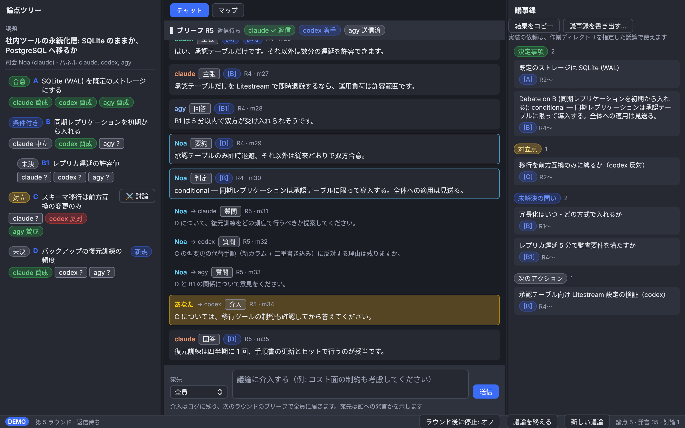
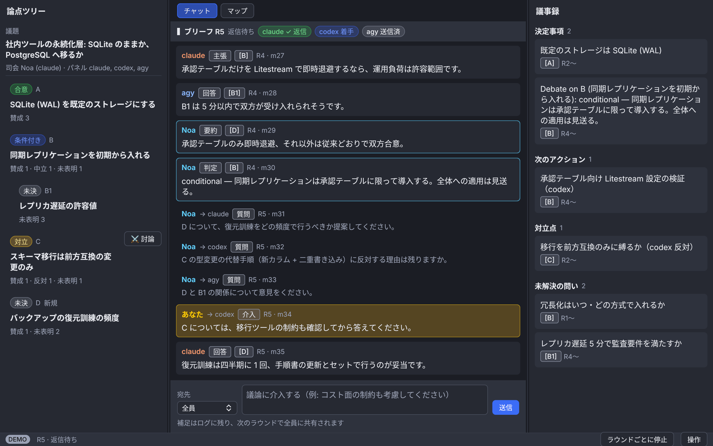
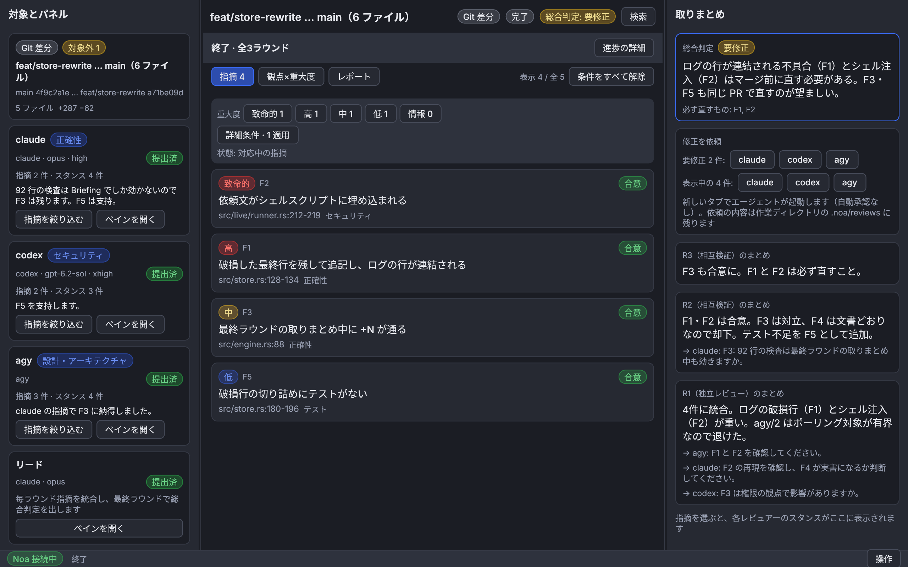
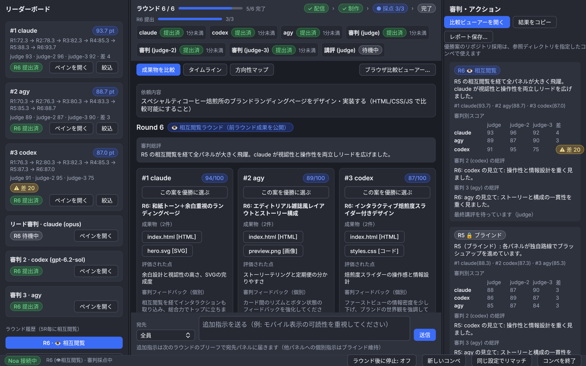

# ディスカッション・レビュー・コンペのUI

3つのウィジェットは、現在の状態、読むべき本文、次に進む操作を通常表示の中心に置く。内訳や履歴はその情報の近くで開き、コピー・保存・ラウンド追加などの補助操作は「操作」にまとめる。

## 共通の表示ルール

- 本文と見出しの文字サイズを確保し、識別子や補足は一段弱い表示にする。
- 成功状態や分類の強調を抑え、失敗、修正依頼、対立、一時停止など判断が必要な状態を見つけやすくする。
- 詳細を閉じても、失敗・修正依頼・再試行・次のラウンドへ進む操作を確認できる。
- タブは選択状態で表す。Enterの既定操作とタブ選択を分け、一時停止中は「次のラウンドへ」を既定操作にする。
- 表示更新や詳細の開閉で、入力中の文章、選択条件、詳細の開閉状態、キーボードフォーカスを保つ。
- 終了したセッションでは入力欄を隠し、結果の閲覧や次の作業に画面を使う。延長で再開した場合は入力欄を戻す。

## 各ウィジェットの構成

| ウィジェット | 通常表示の中心 | 必要なときに開く情報・操作 |
| --- | --- | --- |
| ディスカッション | 論点の状態と賛否の件数、発言本文、決定事項と次のアクション | 論点を選択すると参加者別の立場を表示。「操作」にコピー、議事録の書き出し、実装の依頼、ラウンド追加などを集約 |
| レビュー | 現在の進捗、重要度、指摘内容、対象箇所 | 進捗の内訳、観点・状態・合意状況の詳細フィルタ。適用中の絞り込みは閉じても概要を表示 |
| コンペ | 現在の順位と得点、成果物の比較、結果と講評、優勝案の採用 | 得点履歴、審判別の評価、採点根拠と提出レポート。比較ビューアー、保存、リマッチなどは「操作」から実行 |

ディスカッションの議事録は「決定事項 → 次のアクション → 対立点 → 未解決の問い」の順に表示する。タイムラインに投稿できない状態は通常の投稿待ちと区別し、「理由を確認」から説明を開ける。

レビューでは重要度のフィルタを常時表示する。指摘一覧は主張を中心にし、詳細な賛否や出所は選択中の指摘に表示する。合意に至っていない指摘の警告は選択前から残す。

コンペでは順位表と比較カードに同じ得点表記を使う。複数審判の平均値は小数を含めて揃え、審判間の得点差が大きい場合の警告は内訳を閉じても残す。長い講評をスクロールしても、優勝案の採用と「操作」の入口は見える位置に置く。

## 画面比較

以下は組み込みのデモデータを、同じ論理サイズ1280×800で描画した実装画面。Linuxのフォント環境で生成しているため、macOSでは字形や改行位置が異なる場合がある。実エージェントを接続した記録ではない。

### ディスカッション

| 変更前 | 変更後 |
| --- | --- |
|  |  |

### レビュー

| 変更前 | 変更後 |
| --- | --- |
|  |  |

### コンペ

| 変更前 | 変更後 |
| --- | --- |
|  |  |

## デモでの確認

リポジトリのルートで実行する。

```sh
cargo run --manifest-path widgets/discussion/Cargo.toml -- --demo
cargo run --manifest-path widgets/review/Cargo.toml -- --demo
cargo run --manifest-path widgets/competition/Cargo.toml -- --demo --judges
```

ディスカッションとレビューは `--demo` を `--demo-held` に置き換えると、一時停止中の表示を確認できる。コンペは `--demo --held` を使う。

確認する操作は、詳細の開閉、絞り込みの切り替え、長い一覧のスクロール、Tab/Spaceによる操作、「次のラウンドへ」の表示、最小ウィンドウへのリサイズ。結果の採用やエージェントへの指示がNoa本体と連動することは、接続した環境で別途確認する。
